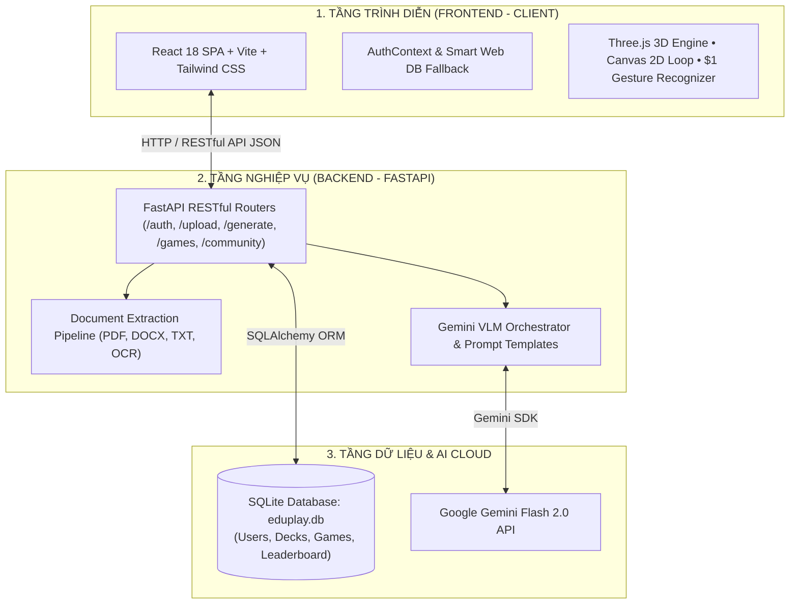
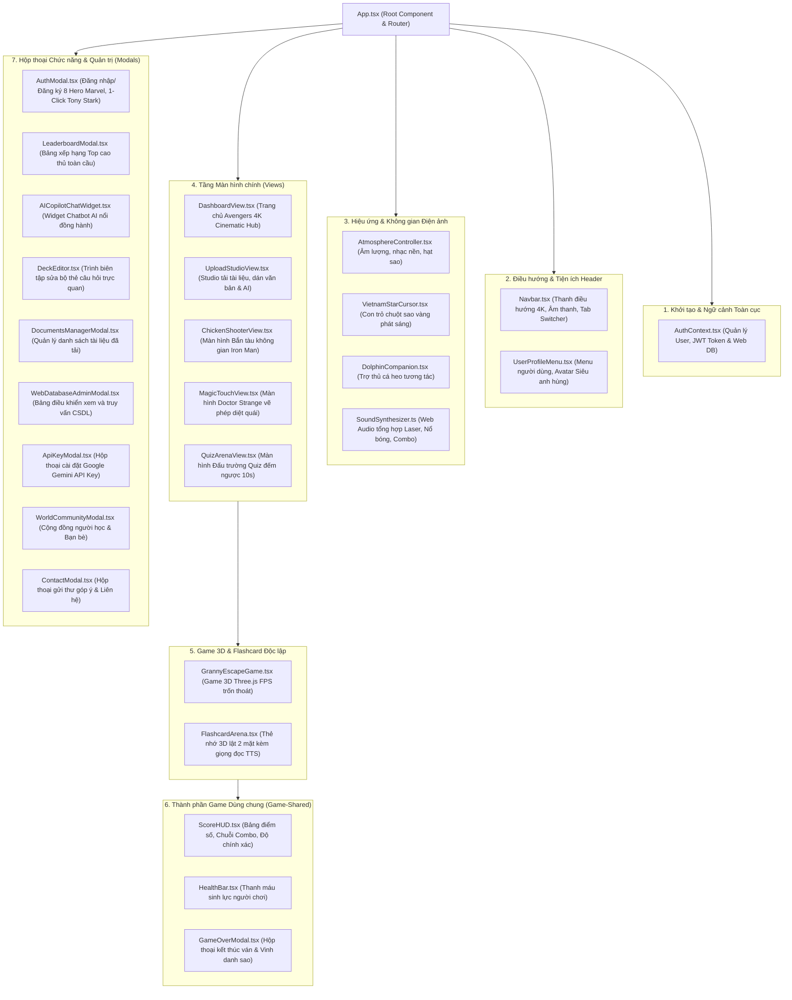
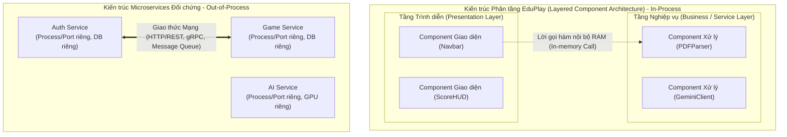

# BÁO CÁO THIẾT KẾ VÀ ĐẶC TẢ KIẾN TRÚC HỆ THỐNG
## DỰ ÁN: NỀN TẢNG HỌC TẬP TRÒ CHƠI HÓA THÔNG MINH (EDUPLAY AI)

---

## 📑 MỤC LỤC
1. [Xác định Loại Kiến trúc và Khẳng định Bản chất](#1-xác-định-loại-kiến-trúc-và-khẳng-định-bản-chất)
2. [Chứng minh Thực tế qua Mã Nguồn Hệ thống (Code Proofs)](#2-chứng-minh-thực-tế-qua-mã-nguồn-hệ-thống-code-proofs)
3. [Đặc tả Toàn diện Các Components của Giao diện (Frontend)](#3-đặc-tả-toàn-diện-các-components-của-giao-diện-frontend)
4. [Đặc tả Toàn diện Các Services trong Backend](#4-đặc-tả-toàn-diện-các-services-trong-backend)
5. [Ma trận Đối chiếu Kỹ thuật: Layered Components vs Distributed Microservices](#5-ma-trận-đối-chiếu-kỹ-thuật-layered-components-vs-distributed-microservices)
6. [Tóm tắt Nhanh Phục vụ Báo cáo & Vấn đáp](#6-tóm-tắt-nhanh-phục-vụ-báo-cáo--vấn-đáp)

---

## 1. XÁC ĐỊNH LOẠI KIẾN TRÚC VÀ KHẲNG ĐỊNH BẢN CHẤT

### 1.1. Mô hình Kiến trúc Tổng thể
Hệ thống **EduPlay** được xây dựng dựa trên nguyên lý **Phân tách Trách nhiệm (Separation of Concerns - SoC)**, kết hợp hai mô hình chuẩn trong kỹ nghệ phần mềm hiện đại:
- **Kiến trúc Khách - Chủ 3 tầng tách rời (Decoupled Client-Server / Modern 3-Tier Layered Architecture)**:
  - **Tầng 1 - Presentation Tier (Tầng trình diễn / Frontend)**: Ứng dụng Single Page Application (SPA) độc lập, viết bằng **React 18 + TypeScript + Vite**, chạy và kết xuất đồ họa thời gian thực trực tiếp trên trình duyệt người dùng.
  - **Tầng 2 - Application / Logic Tier (Tầng ứng dụng & nghiệp vụ / Backend)**: RESTful API Server độc lập xây dựng bằng **FastAPI (Python 3.10+)**, điều phối logic nghiệp vụ, bảo mật JWT, xử lý tài liệu và AI.
  - **Tầng 3 - Data & External Services Tier (Tầng dữ liệu và Dịch vụ ngoài)**: Cơ sở dữ liệu quan hệ **SQLite** (`eduplay.db` qua SQLAlchemy ORM) kết hợp dịch vụ trí tuệ nhân tạo **Google Gemini Flash 2.0 API**.
- **Kiến trúc Nội bộ Backend: Khối module hóa (Modular Monolith)**:
  - Toàn bộ các module nghiệp vụ (*Auth, Parsers, AI Generator, Decks, Games, Community, Admin*) được tổ chức thành các thư mục độc lập nhưng **chạy chung trong một tiến trình thực thi duy nhất (Single Runtime Process)** và chia sẻ chung một cơ sở dữ liệu `eduplay.db`.



### 1.2. Khẳng định Cốt lõi
> **KẾT LUẬN XÁC ĐÁNG:**  
> **Kiến trúc hệ thống đang sử dụng là COMPONENT TRONG KIẾN TRÚC PHÂN TẦNG (Layered Architecture), HOÀN TOÀN KHÔNG PHẢI là Service trong kiến trúc Microservices.**

*Từ "service"* xuất hiện trong thư mục `backend/app/services/` của dự án chỉ là tên gọi của **Tầng nghiệp vụ (Service Layer / Business Logic Layer)** theo mô hình phân tầng truyền thống, chứ **không phải** là các dịch vụ siêu nhỏ độc lập (Microservices).

---

## 2. CHỨNG MINH THỰC TẾ QUA MÃ NGUỒN HỆ THỐNG (CODE PROOFS)

Dưới đây là 4 bằng chứng kỹ thuật trực tiếp từ mã nguồn chứng minh hệ thống là **Component trong Kiến trúc Layer**:

### 📌 Bằng chứng 1: Điểm khởi chạy đơn tiến trình (Single In-Process Runtime)
Trong Microservices, mỗi Service bắt buộc phải chạy trên một tiến trình riêng, chiếm một cổng mạng (Port) riêng hoặc đóng gói trong một Docker Container riêng (ví dụ: Auth port 8001, AI port 8002, Game port 8003).

Trong file `backend/app/main.py`, toàn bộ hệ thống được khởi tạo và chạy chung trong **một tiến trình Python duy nhất**:

```python
# Trích dẫn từ backend/app/main.py:
from fastapi import FastAPI
from .api.v1 import upload, generate, decks, auth, games, documents, chat, community, contact, admin_db

# 1. Khởi tạo DUY NHẤT một ứng dụng FastAPI
app = FastAPI(title=settings.PROJECT_NAME, version="2.1.0")

# 2. Gom TẤT CẢ các module vào chung một biến app trong cùng bộ nhớ
app.include_router(auth.router, prefix="/api/v1", tags=["Authentication"])
app.include_router(upload.router, prefix="/api/v1", tags=["Upload & Parse"])
app.include_router(generate.router, prefix="/api/v1", tags=["AI Content Generator"])
app.include_router(decks.router, prefix="/api/v1", tags=["Learning Decks"])
app.include_router(games.router, prefix="/api/v1", tags=["Games & Leaderboard"])

# 3. Lắng nghe trên DUY NHẤT một cổng mạng 8000
if __name__ == "__main__":
    import uvicorn
    uvicorn.run("app.main:app", host="127.0.0.1", port=8000, reload=True)
```
👉 **Kết luận**: Tất cả các module cùng nằm trong 1 Process ID (PID) của hệ điều hành, cùng chia sẻ chung RAM và CPU. Đây là đặc trưng cốt lõi của **Kiến trúc Monolith / Phân tầng (In-Process)**.

---

### 📌 Bằng chứng 2: Cơ chế tương tác nội bộ bằng Lời gọi hàm trực tiếp trong RAM (In-Memory Function Calls)
Trong Microservices, các service nằm ở các máy chủ/tiến trình khác nhau nên **không thể import code của nhau**, mà bắt buộc phải gửi gói tin qua mạng (Network Calls) bằng HTTP/REST, gRPC hoặc Message Queue.

Trong dự án EduPlay, các thành phần gọi nhau trực tiếp bằng lệnh `import` của Python và thực thi phương thức trong bộ nhớ RAM:

1. Trong `backend/app/api/v1/upload.py`:
```python
# Router upload import trực tiếp class VLMEngine từ tầng Service
from ...services.ai.vlm_engine import VLMEngine

vlm_engine = VLMEngine()

@router.post("/upload")
async def upload_document(...):
    # Gọi hàm trực tiếp trong RAM (In-memory execution), không hề qua mạng HTTP
    raw_text, learning_pkg, vlm_mode = vlm_engine.process_file(
        file_path=temp_path,
        filename=filename,
        user_api_key=x_gemini_key,
        custom_prompt=custom_prompt
    )
```

2. Tiếp tục bên trong `backend/app/services/ai/vlm_engine.py`:
```python
# VLMEngine lại import trực tiếp các Parser components khác trong cùng thư mục
elif ext in [".docx", ".doc"]:
    from ..parsers.docx_parser import DocxParser
    raw_text = DocxParser().parse(file_path)  # Lời gọi hàm trực tiếp trong RAM

else:
    from ..parsers.txt_parser import TextParser
    raw_text = TextParser().parse(file_path)   # Lời gọi hàm trực tiếp trong RAM
```
👉 **Kết luận**: Việc dùng `from ... import ...` và gọi hàm trực tiếp với tốc độ nano-giây chứng minh `DocxParser`, `VLMEngine`, `upload.py` là các **Components (thành phần phần mềm)** nằm trong các tầng logic khác nhau của cùng một khối ứng dụng, không phải là Microservices độc lập.

---

### 📌 Bằng chứng 3: Cơ sở dữ liệu tập trung dùng chung và Khóa ngoại ORM (Shared Centralized Database)
Nguyên tắc bất di bất dịch của Microservices là **Database-per-Service** (Mỗi service phải có Database riêng; dịch vụ Game không được phép truy cập trực tiếp vào Database của dịch vụ Auth hay Decks).

Trong dự án EduPlay:
1. File `backend/app/db/session.py` chỉ khởi tạo **duy nhất một Engine kết nối** vào một file SQLite chung `backend/eduplay.db`:
```python
engine = create_engine(settings.DATABASE_URL, connect_args={"check_same_thread": False})
SessionLocal = sessionmaker(autocommit=False, autoflush=False, bind=engine)
Base = declarative_base()
```

2. File `backend/app/db/models.py` định nghĩa tất cả các bảng dữ liệu kế thừa chung từ một `Base`, và các bảng có **Khóa ngoại quan hệ trực tiếp (Foreign Key)** với nhau:
```python
class UserEntity(Base):
    __tablename__ = "users"
    id = Column(String(36), primary_key=True)
    # Quan hệ trực tiếp với bảng Packages và GameSessions
    packages = relationship("PackageEntity", back_populates="creator")
    game_sessions = relationship("GameSessionEntity", back_populates="user")

class PackageEntity(Base):
    __tablename__ = "learning_packages"
    package_id = Column(String(64), primary_key=True)
    
    # Khóa ngoại trỏ thẳng đến bảng users trong cùng 1 Database
    user_id = Column(String(36), ForeignKey("users.id", ondelete="SET NULL"))
    creator = relationship("UserEntity", back_populates="packages")
```
👉 **Kết luận**: Trong Microservices, **tuyệt đối không thể tạo khóa ngoại `ForeignKey("users.id")`** trỏ sang một database của service khác. Việc toàn bộ các bảng dùng chung file CSDL `eduplay.db` và có quan hệ khóa ngoại trực tiếp là minh chứng rõ ràng nhất của **Kiến trúc Monolith / Phân tầng**.

---

### 📌 Bằng chứng 4: Sự phân chia các Tầng (Layers) rõ rệt trong cấu trúc thư mục
Hệ thống được tổ chức hoàn hảo theo đúng 4 tầng của mô hình **Layered Architecture**:

```
m:\Game\
│
├── [TẦNG 1: PRESENTATION LAYER - GIAO DIỆN CLIENT]
│   └── frontend/src/components/       -> Chứa các UI Components (Navbar.tsx, ScoreHUD.tsx, GrannyEscapeGame.tsx)
│   └── frontend/src/lib/api.ts        -> Tầng giao tiếp HTTP gọi xuống Backend
│
├── [TẦNG 2: CONTROLLER / API ROUTER LAYER]
│   └── backend/app/api/v1/            -> Chứa các API Components (auth.py, upload.py, games.py)
│                                         Nhiệm vụ: Nhận HTTP request, validate dữ liệu bằng Pydantic schemas
│
├── [TẦNG 3: BUSINESS LOGIC / SERVICE LAYER]
│   └── backend/app/services/parsers/  -> Chứa các Components xử lý bóc tách file (PDF, Docx, OCR)
│   └── backend/app/services/ai/       -> Chứa các Components thuật toán AI (vlm_engine.py, content_generator.py)
│                                         Nhiệm vụ: Thuần túy tính toán nghiệp vụ, không phụ thuộc HTTP
│
└── [TẦNG 4: DATA ACCESS / PERSISTENCE LAYER]
    └── backend/app/db/models.py       -> Các Entity ánh xạ bảng CSDL
    └── backend/app/db/session.py      -> Quản lý kết nối ORM SQLAlchemy với file eduplay.db
```

Luồng dữ liệu tuân thủ nghiêm ngặt chiều từ trên xuống dưới của Kiến trúc Phân tầng:
$$\text{UI Component (Frontend)} \longrightarrow \text{API Router (Controller)} \longrightarrow \text{Service Component (Logic)} \longrightarrow \text{ORM Model (Database)}$$

---

## 3. ĐẶC TẢ TOÀN DIỆN CÁC COMPONENTS CỦA GIAO DIỆN (FRONTEND)

Trong thư mục `frontend/src`, giao diện người dùng được phân rã thành các **Components** tái sử dụng, phân cấp theo cây cấu trúc gồm 7 nhóm chức năng hoàn chỉnh:



### Bảng đặc tả chi tiết 7 nhóm Component giao diện:

| STT | Nhóm Component | Tên File / Module | Chức Năng Kỹ Thuật Chi Tiết |
| :---: | :--- | :--- | :--- |
| **1** | **Khởi tạo & Ngữ cảnh Toàn cục** | `App.tsx`<br>`AuthContext.tsx` | - `App.tsx`: Điều phối chuyển đổi Tab hiển thị (State Router), nạp bài học mặc định toàn cục.<br>- `AuthContext.tsx`: Cung cấp React Context quản lý trạng thái đăng nhập, lưu JWT Token và kích hoạt cơ chế **Web Database Fallback** khi triển khai trên Vercel. |
| **2** | **Điều hướng & Header** | `Navbar.tsx`<br>`UserProfileMenu.tsx` | - `Navbar.tsx`: Header phong cách Cyberpunk 4K, chuyển Tab (Dashboard, Upload, Games, Leaderboard), bật tắt nhạc nền.<br>- `UserProfileMenu.tsx`: Menu xem thông tin cá nhân, cấp bậc chiến binh và thay đổi Avatar Siêu Anh Hùng. |
| **3** | **Hiệu ứng & Không gian Âm thanh** | `AtmosphereController.tsx`<br>`VietnamStarCursor.tsx`<br>`DolphinCompanion.tsx`<br>`SoundSynthesizer.ts` | - `AtmosphereController.tsx`: Tự động đồng bộ hóa nhạc nền và nhịp điệu ánh sáng môi trường.<br>- `VietnamStarCursor.tsx`: Con trỏ chuột hình ngôi sao vàng phát sáng vệt sao.<br>- `DolphinCompanion.tsx`: Trợ thủ cá heo 3D tương tác, chúc mừng khi đạt chuỗi Combo.<br>- `SoundSynthesizer.ts`: Bộ tổng hợp âm thanh số bằng Web Audio API thuần (tiếng bắn Laser, nổ bóng, tiếng vỗ tay). |
| **4** | **Tầng Màn hình chính (Views)** | `DashboardView.tsx`<br>`UploadStudioView.tsx`<br>`ChickenShooterView.tsx`<br>`MagicTouchView.tsx`<br>`QuizArenaView.tsx` | - `DashboardView.tsx`: Banner 4K Avengers, thống kê tiến độ học tập và cổng vào 5 chế độ chơi.<br>- `UploadStudioView.tsx`: Khu vực tải tài liệu PDF, DOCX, Ảnh OCR hoặc dán văn bản để AI tạo bài học.<br>- `ChickenShooterView.tsx`: GameLoop bắn tàu vũ trụ 60 FPS kết hợp bàn phím nhận diện gõ chữ.<br>- `MagicTouchView.tsx`: Bảng vẽ Canvas 2D nhận dạng cử chỉ nét vẽ diệt quái.<br>- `QuizArenaView.tsx`: Đấu trường thi đấu trắc nghiệm đếm ngược 10 giây với hiệu ứng combo. |
| **5** | **Game 3D & Flashcard Độc lập** | `GrannyEscapeGame.tsx`<br>`FlashcardArena.tsx` | - `GrannyEscapeGame.tsx`: Render không gian phòng giam 3D thời gian thực bằng **Three.js** và `@react-three/fiber`, camera FPS góc nhìn thứ nhất, giải câu đố từ vựng để mở cổng thoát hiểm.<br>- `FlashcardArena.tsx`: Thẻ học không gian 3D lật mặt mượt mà, tích hợp Text-to-Speech (TTS) phát âm chuẩn bản xứ, hỗ trợ lặp lại ngắt quãng (Spaced Repetition). |
| **6** | **Thành phần Game dùng chung** | `ScoreHUD.tsx`<br>`HealthBar.tsx`<br>`GameOverModal.tsx` | - `ScoreHUD.tsx`: Hiển thị điểm số, cấp độ nhân điểm (x1 -> x4), thời gian còn lại.<br>- `HealthBar.tsx`: Thanh máu sinh lực có hiệu ứng rung lắc (screen shake) khi nhận sát thương.<br>- `GameOverModal.tsx`: Hộp thoại tổng kết ván chơi hiển thị số từ đã thuộc, độ chính xác (%) và số sao vinh danh. |
| **7** | **Hộp thoại Chức năng & Quản trị** | `AuthModal.tsx`<br>`LeaderboardModal.tsx`<br>`AICopilotChatWidget.tsx`<br>`DeckEditor.tsx`<br>`DocumentsManagerModal.tsx`<br>`WebDatabaseAdminModal.tsx`<br>`ApiKeyModal.tsx`<br>`WorldCommunityModal.tsx`<br>`ContactModal.tsx` | - `AuthModal.tsx`: Đăng nhập/đăng ký với 8 nhân vật Marvel, nút *"Điền tài khoản mẫu (Tony Stark)"* 1-click, hỗ trợ OAuth.<br>- `LeaderboardModal.tsx`: Bảng vàng xếp hạng Top cao thủ toàn cầu.<br>- `AICopilotChatWidget.tsx`: Khung chat thu nhỏ nổi ở góc màn hình, gia sư AI giải đáp thắc mắc 24/7.<br>- `DeckEditor.tsx`: Cho phép chỉnh sửa câu hỏi, đáp án A-B-C-D và lời giải thích.<br>- `DocumentsManagerModal.tsx`: Quản lý danh sách các file tài liệu đã tải lên.<br>- `WebDatabaseAdminModal.tsx`: Giao diện Admin quản trị và truy vấn CSDL SQLite trực quan.<br>- `ApiKeyModal.tsx`, `WorldCommunityModal.tsx`, `ContactModal.tsx`: Cấu hình API key, kết bạn và liên hệ hỗ trợ. |

---

## 4. ĐẶC TẢ TOÀN DIỆN CÁC SERVICES TRONG BACKEND

Backend (`backend/app`) được phân chia thành 7 phân hệ **Services** nội bộ chuyên trách theo từng phân tầng nghiệp vụ:

| STT | Phân Hệ Dịch Vụ | File Mã Nguồn Cụ Thể | Chức Năng Kỹ Thuật Chi Tiết |
| :---: | :--- | :--- | :--- |
| **1** | **Dịch vụ Bóc tách Tài liệu (Parser Services)** | `base_parser.py`<br>`pdf_parser.py`<br>`docx_parser.py`<br>`txt_parser.py`<br>`image_parser.py` | - `base_parser.py`: Định nghĩa Interface trừu tượng `BaseParser` chuẩn hóa phương thức bóc tách.<br>- `pdf_parser.py`: Sử dụng thư viện `pypdf` bóc tách cấu trúc phân trang của sách giáo trình PDF.<br>- `docx_parser.py`: Sử dụng `python-docx` đọc hiểu văn bản, danh sách gạch đầu dòng trong tài liệu Word.<br>- `txt_parser.py`: Đọc file văn bản thuần, tự động nhận diện bảng mã UTF-8 tiếng Việt.<br>- `image_parser.py`: Tích hợp Gemini Vision OCR nhận diện chữ in và chữ viết tay từ ảnh chụp bài giảng. |
| **2** | **Dịch vụ Trí tuệ Nhân tạo (AI & VLM Services)** | `gemini_client.py`<br>`prompt_templates.py`<br>`content_generator.py`<br>`vlm_engine.py` | - `gemini_client.py`: Quản lý kết nối Google Gemini Flash 2.0 API, thiết lập cấu hình tham số sinh và ép kiểu đầu ra JSON Schema chuẩn.<br>- `prompt_templates.py`: Kho lưu trữ System Prompt kỹ thuật tối ưu hóa cho từng môn học.<br>- `content_generator.py`: Điều phối luồng xử lý AI, phân loại độ khó và kích hoạt **Fallback Heuristic** (dùng dữ liệu mẫu) khi mất kết nối mạng.<br>- `vlm_engine.py`: Lõi xử lý đa phương thức kết hợp văn bản và hình ảnh học tập. |
| **3** | **Dịch vụ Xác thực & Bảo mật (Auth & Security Services)** | `core/security.py`<br>`api/v1/auth.py`<br>`core/deps.py` | - `core/security.py`: Mã hóa mật khẩu một chiều bằng thuật toán an toàn `Bcrypt / Passlib`; sinh và kiểm tra chữ ký điện tử **JWT Bearer Token**.<br>- `api/v1/auth.py`: Xử lý endpoint đăng ký tài khoản, đăng nhập, lấy hồ sơ cá nhân (`/auth/me`) và cập nhật Avatar (`/auth/profile`).<br>- `core/deps.py`: Dependency Middleware xác thực token và kiểm tra phân quyền truy cập `user` vs `admin`. |
| **4** | **Dịch vụ Quản lý Bài học (Decks & Data Services)** | `api/v1/decks.py`<br>`services/sample_data.py` | - `api/v1/decks.py`: Quản lý các gói học tập `LearningPackage`, lưu trữ và nạp các bộ câu hỏi `QuizDeck` và từ vựng `VocabularyDeck`.<br>- `services/sample_data.py`: Cung cấp kho dữ liệu mẫu chuẩn (Tiếng Trung HSK1, Tiếng Anh CNTT) để hệ thống hoạt động ngay cả khi ngoại tuyến. |
| **5** | **Dịch vụ Ghi nhận & Xếp hạng (Game Analytics Services)** | `api/v1/games.py` | - Lưu trữ chi tiết thông số từng ván chơi (`game_sessions`): số điểm, độ chính xác (accuracy), chuỗi combo cao nhất, thời gian chơi.<br>- Tổng hợp và tính toán danh sách Top người chơi đạt điểm cao nhất toàn cầu trên Bảng xếp hạng (`/games/leaderboard`). |
| **6** | **Dịch vụ Quản trị CSDL (Web Database Admin Services)** | `api/v1/admin_db.py` | - Trích xuất lược đồ (Schema) CSDL SQLite (`eduplay.db`), liệt kê danh sách các bảng và số lượng dòng dữ liệu.<br>- Hỗ trợ xem dữ liệu có phân trang, tìm kiếm bản ghi theo từ khóa và xóa dữ liệu trực tiếp từ giao diện Admin. |
| **7** | **Dịch vụ Tương tác & Cộng đồng (Chat & Community Services)** | `api/v1/chat.py`<br>`api/v1/community.py`<br>`api/v1/contact.py` | - `api/v1/chat.py`: Xử lý phòng chat thế giới và kết nối trực tiếp với Trợ lý ảo AI Copilot giải đáp bài tập.<br>- `api/v1/community.py`: Quản lý danh sách thành viên và tính năng gửi lời mời kết bạn.<br>- `api/v1/contact.py`: Tiếp nhận ý kiến đóng góp và phản hồi từ người học. |

---

## 5. MA TRẬN ĐỐI CHIẾU KỸ THUẬT: LAYERED COMPONENTS VS DISTRIBUTED MICROSERVICES



| Tiêu Chí Kỹ Thuật | Component (trong Kiến trúc Phân tầng Layered - Dự án EduPlay) | Service (trong Kiến trúc Microservices Phân tán) |
| :--- | :--- | :--- |
| **1. Bản chất Kiến trúc** | Là một **đơn vị cấu thành mã nguồn** (Module, Class, File, Function) nằm bên trong một tầng logic của ứng dụng. | Là một **tiến trình phần mềm hoàn chỉnh, độc lập** (Autonomous Service Process) đại diện cho một nghiệp vụ doanh nghiệp. |
| **2. Môi trường Thực thi (Runtime)** | Chạy **trong cùng một tiến trình (In-Process)**. Chia sẻ chung không gian bộ nhớ RAM, CPU của máy chủ ứng dụng. | Chạy trên **các tiến trình riêng biệt (Out-of-Process)**. Thường được đóng gói trong các Container riêng (Docker, Kubernetes) hoặc máy chủ riêng. |
| **3. Giao thức Giao tiếp** | Sử dụng **lời gọi hàm trực tiếp trong RAM (In-Memory Method Call)**. Tốc độ thực thi cực nhanh (nano-giây), không có độ trễ mạng. | Sử dụng **Giao thức Mạng (Network Protocols)** như HTTP/REST, gRPC, WebSocket hoặc Message Broker (Kafka, RabbitMQ). Có độ trễ mạng. |
| **4. Chiến lược Quản lý Dữ liệu** | **Cơ sở dữ liệu tập trung dùng chung (Shared Database)**. Mọi Component trong tầng Business Logic đều thao tác với cùng một CSDL. | Tuân theo nguyên tắc **Database-per-Service**: Mỗi Service quản lý một CSDL độc lập, nghiêm cấm truy cập trực tiếp chéo CSDL. |
| **5. Mô hình Triển khai** | **Triển khai đồng loạt (Atomic/Monolithic Deploy)**: Khi cập nhật một Component, toàn bộ ứng dụng Backend được đóng gói và triển khai cùng nhau. | **Triển khai độc lập (Independent Deployability)**: Mỗi Service có pipeline CI/CD riêng, có thể triển khai cập nhật Service A mà không ảnh hưởng tới Service B. |
| **6. Chiến lược Co giãn (Scaling)** | Mở rộng theo chiều ngang (Scale) bằng cách nhân bản **toàn bộ tiến trình ứng dụng Backend**. | **Co giãn linh hoạt từng phần (Granular Scaling)**: Có thể cấp riêng tài nguyên phần cứng (CPU/GPU) cho Service có tải trọng lớn (ví dụ AI Service). |
| **7. Ranh giới Công nghệ** | Thống nhất trong **cùng một nền tảng ngôn ngữ và runtime** của tầng đó (toàn bộ Backend sử dụng Python / FastAPI). | **Đa ngôn ngữ linh hoạt (Polyglot Architecture)**: Mỗi Service có thể lựa chọn công nghệ riêng biệt (Python, Go, Node.js, Java). |
| **8. Minh chứng Thực tế trong EduPlay** | - `pdf_parser.py`, `gemini_client.py` là các **Component** thuộc tầng Business Logic của Backend.<br>- `Navbar.tsx`, `ScoreHUD.tsx` là các **Component** thuộc tầng Presentation của Frontend. | Trường hợp tách riêng bộ xử lý AI thành một máy chủ độc lập chạy cổng riêng với Database riêng giao tiếp qua gRPC, lúc đó mới hình thành **Microservice**. |

---

## 6. TÓM TẮT NHANH PHỤC VỤ BÁO CÁO & VẤN ĐÁP

### 1. Loại kiến trúc đang sử dụng:
- **Kiến trúc tổng thể**: 3 tầng tách rời (**3-Tier Decoupled Architecture**) kết hợp **Modular Monolith** ở Backend.
- **Khẳng định**: Hệ thống sử dụng **COMPONENT TRONG KIẾN TRÚC PHÂN TẦNG**, **không phải** Service trong Microservices.
- **3 điểm chứng minh từ code**:
  1. *Đơn tiến trình*: Cả hệ thống chạy trong 1 tiến trình duy nhất (`backend/app/main.py` cổng 8000).
  2. *Giao tiếp qua RAM*: Các module import và gọi hàm trực tiếp trong RAM (`from ...services... import ...`), không qua mạng.
  3. *CSDL dùng chung*: Tất cả các bảng lưu trong 1 file SQLite `eduplay.db` và liên kết bằng khóa ngoại `ForeignKey("users.id")`.

### 2. Components của giao diện (Frontend):
Gồm **7 nhóm**: (1) Khởi tạo/Context, (2) Header/Điều hướng, (3) Hiệu ứng/Âm thanh, (4) 5 Màn hình Views, (5) Game 3D & Flashcard, (6) Thành phần Game dùng chung, (7) Hộp thoại Modals chức năng.

### 3. Services trong Backend:
Gồm **7 phân hệ**: (1) Bóc tách tài liệu (Parsers), (2) Trí tuệ nhân tạo (AI & VLM), (3) Xác thực & Bảo mật (JWT/Bcrypt), (4) Quản lý bài học (Decks), (5) Kết quả & Xếp hạng (Games), (6) Quản trị CSDL (Web DB Admin), (7) Chat & Cộng đồng.

### 4. Khác biệt cốt lõi nhất:
- **Component trong Kiến trúc Layer**: Cùng 1 tiến trình (In-Process), gọi hàm trong RAM, 1 Database chung, deploy đồng loạt. *(Hệ thống EduPlay)*
- **Service trong Microservices**: Tách riêng nhiều tiến trình (Out-of-Process), gửi gói tin qua mạng, mỗi service 1 Database riêng, deploy độc lập.
