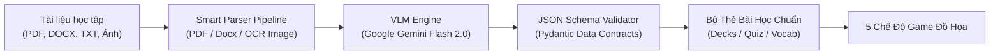
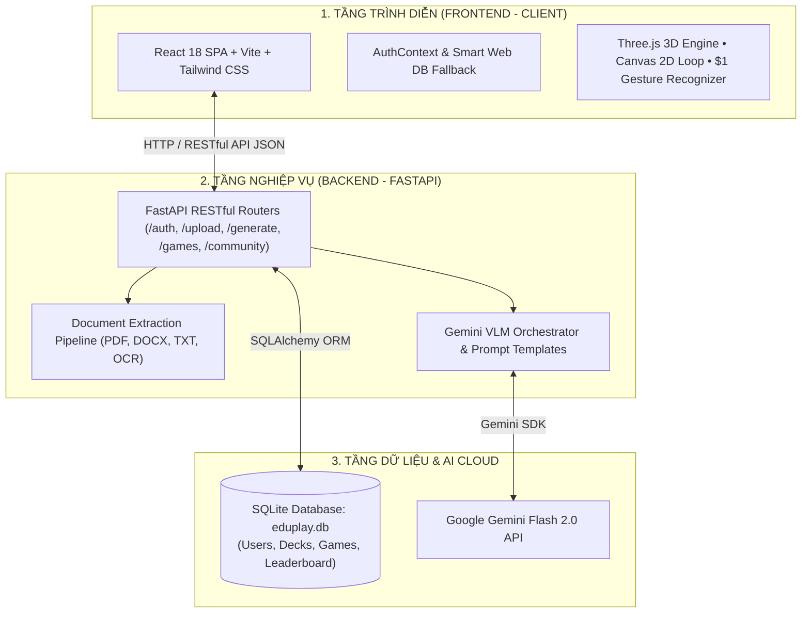

<div align="center">

# 🎮 EDUPLAY AI - NỀN TẢNG HỌC TẬP TRÒ CHƠI HÓA 4K & VLM MULTIMODAL
### *Gamified AI Learning Platform • Powered by Google Gemini & Three.js 3D*

[](https://vercel.com)
[](https://reactjs.org/)
[](https://www.typescriptlang.org/)
[](https://threejs.org/)
[](https://fastapi.tiangolo.com/)
[](https://ai.google.dev/)
[](LICENSE)

<br/>

> **EduPlay** là nền tảng giáo dục tương tác thế hệ mới, ứng dụng **Trí tuệ Nhân tạo Đa phương thức (Multimodal VLM)** và **Đồ họa 3D thời gian thực**. Hệ thống tự động phân tích mọi loại tài liệu học tập thô (sách giáo trình PDF, file Word DOCX, văn bản TXT, hình ảnh chụp bài giảng) để biến thành các **đấu trường trò chơi sinh động**, giúp nâng cao 300% khả năng ghi nhớ và tạo cảm hứng học tập bất tận.

[🌐 Trải Nghiệm Web Trực Tiếp](#-triển-khai-lên-web-deployment) • [✨ Tính Năng Nổi Bật](#-tính-năng-nổi-bật) • [🏗️ Kiến Trúc Hệ Thống](#-kiến-trúc-hệ-thống) • [🚀 Cài Đặt & Khởi Chạy](#-cài-đặt--khởi-chạy-nhanh) • [📚 Tài Liệu API](#-tài-liệu-api-endpoints)

---

</div>

## 📑 MỤC LỤC
1. [Giới thiệu Dự án](#-giới-thiệu-dự-án)
2. [5 Chế độ Trò chơi Độc quyền](#-5-chế-độ-trò-chơi-độc-quyền)
3. [Lõi Xử lý AI Đa Phương Thức (VLM Engine)](#-lõi-xử-lý-ai-đa-phương-thức-vlm-engine)
4. [Kiến Trúc Hệ Thống (System Architecture)](#-kiến-trúc-hệ-thống)
5. [Công Nghệ Sử Dụng (Tech Stack)](#-công-nghệ-sử-dụng-tech-stack)
6. [Cấu Trúc Thư Mục Chuẩn Hóa](#-cấu-trúc-thư-mục-chuẩn-hóa)
7. [Cài Đặt & Khởi Chạy Nhanh](#-cài-đặt--khởi-chạy-nhanh)
8. [Triển Khai Lên Web (Deployment)](#-triển-khai-lên-web-deployment)
9. [Tài Liệu API Endpoints](#-tài-liệu-api-endpoints)
10. [Bản Quyền & Tác Giả](#-bản-quyền--tác-giả)

---

## 🌟 GIỚI THIỆU DỰ ÁN

Hầu hết các nền tảng học tập trực tuyến hiện nay chỉ dừng lại ở các bài trắc nghiệm nhàm chán hoặc flashcard thụ động. **EduPlay** giải quyết triệt để vấn đề này bằng việc kết hợp giữa:
- **Gamification (Trò chơi hóa)**: Đưa kiến thức vào các thử thách phản xạ bàn phím, vẽ nét phép thuật cử chỉ, đấu trường trí tuệ và game sinh tồn 3D trốn thoát.
- **Multimodal AI Pipeline**: Đọc hiểu cấu trúc văn bản học thuật, tự động phát hiện từ vựng trọng tâm, sinh câu hỏi trắc nghiệm kèm giải thích logic bằng mô hình ngôn ngữ lớn **Google Gemini Flash 2.0**.
- **Cinematic Experience**: Giao diện chuẩn **4K Ultra-HD phong cách Siêu Anh Hùng Avengers**, hiệu ứng âm thanh sống động (Web Audio API), trợ lý ảo AI Copilot đồng hành 24/7.

---

## 🎮 5 CHẾ ĐỘ TRÒ CHƠI ĐỘC QUYỀN

| STT | Tựa Game | Công Nghệ Engine | Cơ Chế Học Tập & Tương Tác |
| :---: | :--- | :--- | :--- |
| **1** | **Granny 3D Escape Room** | **Three.js / React Three Fiber** | Game sinh tồn 3D góc nhìn thứ nhất (FPS). Người chơi phải giải các câu đố từ vựng để mở khóa cửa thoát hiểm trước khi bị Bà Ngoại bắt giữ. |
| **2** | **Doctor Strange Magic Touch** | **HTML5 Canvas 2D + $1 Gesture** | Quái vật bay trên các quả bóng mang ký tự. Người chơi dùng chuột hoặc vuốt cảm ứng để vẽ nét phép thuật, hệ thống nhận diện cử chỉ tức thời để phá hủy bóng bay. |
| **3** | **Iron Man Chicken Shooter** | **Custom 2D GameLoop 60 FPS** | Bắn tàu không gian luyện gõ từ vựng / Pinyin. Tàu chiến tự động khóa mục tiêu và bắn tia Laser hủy diệt quái vật khi người chơi gõ đúng phím. |
| **4** | **Stark Tech Speed Quiz Arena** | **React Animation + Audio FX** | Đấu trường trắc nghiệm đếm ngược 10 giây. Tích lũy Combo chuỗi thắng nhân điểm số x2, x3, x4 kèm phân tích đáp án chi tiết. |
| **5** | **Avengers Flashcard Arena** | **3D Flip Card + Speech TTS** | Lật thẻ ghi nhớ không gian 3D, hỗ trợ phát âm chuẩn bản xứ, tự động thống kê tỉ lệ thuộc bài và ghi nhớ ngắt quãng (Spaced Repetition). |

---

## 🧠 LÕI XỬ LÝ AI ĐA PHƯƠNG THỨC (VLM ENGINE)



- **Đa định dạng đầu vào**: Hỗ trợ bóc tách nội dung từ tài liệu PDF sách giáo khoa, file Word giáo án (`.docx`), file văn bản (`.txt`) và hình ảnh chụp bảng/sách thông qua thị giác máy tính OCR.
- **Trích xuất thông minh**: Tự động nhận diện ngữ cảnh môn học (Ngoại ngữ, Lịch sử, Khoa học, Công nghệ thông tin) và phân loại độ khó.
- **Dữ liệu chuẩn hóa**: Xuất dữ liệu dưới dạng JSON nghiêm ngặt (Câu hỏi, 4 phương án A-B-C-D, đáp án đúng, phân tích chuyên sâu).
- **Cơ chế Fallback thông minh**: Tự động chuyển sang bộ ngân hàng dữ liệu mẫu ngoại tuyến khi mất kết nối mạng hoặc không có API key.

---

## 🏗️ KIẾN TRÚC HỆ THỐNG

Dự án áp dụng mô hình **Kiến Trúc 3 Tầng Hiện Đại (Decoupled 3-Tier Web Architecture)** kết hợp cơ sở dữ liệu kép **(Hybrid Database: SQLite cho Local & Web Storage cho Cloud Demo)**:



---

## 💻 CÔNG NGHỆ SỬ DỤNG (TECH STACK)

| Phân tầng | Công nghệ cốt lõi | Chi tiết tính năng |
| :--- | :--- | :--- |
| **Frontend** | **React 18**, **TypeScript**, **Vite** | Single Page Application tốc độ cao, quản lý State tập trung bằng React Hooks & Context. |
| **Đồ họa & Hiệu ứng** | **Three.js**, **React Three Fiber**, **Tailwind CSS** | Kết xuất 3D không gian, ánh sáng động thời gian thực, hiệu ứng hạt Particle và hoạt ảnh Framer Motion. |
| **Game Engine** | **HTML5 Canvas 2D**, **Web Audio API** | Vòng lặp trò chơi độc lập FPS, thuật toán nhận dạng nét vẽ `$1 Unistroke`, âm thanh tổng hợp đa âm sắc. |
| **Backend API** | **FastAPI (Python 3.10+)**, **Uvicorn** | Máy chủ bất đồng bộ ASGI (async/await), Pydantic validation, chuẩn RESTful JSON. |
| **Trí tuệ nhân tạo (AI)** | **Google Gemini Flash 2.0 API** | Vision-Language Model thế hệ mới, đọc hiểu văn bản và ảnh chụp bài giảng. |
| **Cơ sở dữ liệu** | **SQLite (SQLAlchemy ORM) & LocalStorage DB** | Lưu trữ người dùng, mật khẩu mã hóa bcrypt, bộ câu hỏi, lịch sử ván chơi và bảng xếp hạng. |
| **Bảo mật** | **JWT (JSON Web Token)**, **Passlib Bcrypt** | Xác thực phân quyền Người dùng (User) và Quản trị viên (Admin). |
| **Triển khai (Deploy)** | **Vercel**, **Git Version Control** | Triển khai web 1-click, tự động build SPA với tệp cấu hình tối ưu. |

---

## 📁 CẤU TRÚC THƯ MỤC CHUẨN HÓA

```
M:\Game/
├── frontend/                            # Ứng dụng Client (React 18 + Vite)
│   ├── public/assets/                   # Ảnh nền 4K, texture 3D, âm thanh
│   ├── src/
│   │   ├── components/                  # Giao diện tái sử dụng
│   │   │   ├── admin/                   # WebDatabaseAdminModal (Quản trị CSDL)
│   │   │   ├── auth/                    # AuthModal, Leaderboard, UserProfileMenu
│   │   │   ├── chat/                    # AICopilotChatWidget (Trợ lý AI nổi)
│   │   │   ├── games/                   # GrannyEscapeGame (3D), FlashcardArena
│   │   │   └── upload/                  # DocumentUpload, DeckEditor
│   │   ├── context/                     # AuthContext (Xác thực & phân quyền)
│   │   ├── games/                       # Lõi Game Engines độc lập
│   │   │   ├── chicken-shooter/         # Bắn tàu không gian luyện gõ
│   │   │   ├── magic-touch/             # Vẽ phép diệt quái (Gesture Recognizer)
│   │   │   └── common/                  # GameLoop, ParticleEngine, SoundSynthesizer
│   │   ├── lib/api.ts                   # Tầng API Client tích hợp Web Database Fallback
│   │   └── views/                       # Dashboard, UploadStudio, Game Arenas
│   ├── package.json                     # Quản lý dependencies frontend
│   └── vercel.json                      # Cấu hình rewrite URL cho Vercel SPA
│
├── backend/                             # Máy chủ API (Python FastAPI)
│   ├── app/
│   │   ├── api/v1/                      # Endpoints: auth, upload, generate, games, admin
│   │   ├── core/                        # Cấu hình bảo mật JWT, dependencies
│   │   ├── db/                          # Models SQLAlchemy, khởi tạo CSDL
│   │   ├── models/                      # Pydantic Schemas
│   │   └── services/                    # Parsers tài liệu (PDF, Word, OCR) & AI Generator
│   ├── eduplay.db                       # Cơ sở dữ liệu SQLite
│   └── requirements.txt                 # Thư viện Python Backend
│
├── sample_files/                        # Tài liệu bài học mẫu để test hệ thống
├── start_all.bat                        # Script khởi chạy 1-Click toàn bộ Frontend & Backend
├── package.json                         # Root build script hỗ trợ Vercel
├── vercel.json                          # Root Vercel routing configuration
└── README.md                            # Tài liệu dự án chính thức
```

---

## 🚀 CÀI ĐẶT & KHỞI CHẠY NHANH

### Yêu cầu môi trường:
- **Node.js**: Phiên bản 18.x trở lên.
- **Python**: Phiên bản 3.10 trở lên.
- **Trình duyệt**: Google Chrome, Microsoft Edge, Firefox (khuyên dùng trình duyệt hỗ trợ WebGL để chơi mượt 3D).

---

### Cách 1: Khởi động tự động 1-Click (Dành cho Windows)
Chỉ cần nhấp đúp chuột vào file:
```cmd
start_all.bat
```
Hệ thống sẽ tự động bật 2 cửa sổ song song:
1. **Backend FastAPI**: Đang chạy tại `http://localhost:8000` (kèm tài liệu tương tác tại `http://localhost:8000/docs`).
2. **Frontend React**: Đang chạy tại `http://localhost:5173`.
Trình duyệt sẽ tự động mở trang web EduPlay sẵn sàng để bạn trải nghiệm!

---

### Cách 2: Khởi động thủ công bằng dòng lệnh

#### 1. Khởi chạy Backend:
```bash
cd backend
python -m venv venv
venv\Scripts\activate       # Trên Windows (hoặc: source venv/bin/activate trên Mac/Linux)
pip install -r requirements.txt
python -m uvicorn app.main:app --host 127.0.0.1 --port 8000 --reload
```

#### 2. Khởi chạy Frontend:
Mở một cửa sổ dòng lệnh mới:
```bash
cd frontend
npm install
npm run dev
```
Truy cập đường dẫn: **`http://localhost:5173`**

---

## 🌐 TRIỂN KHAI LÊN WEB (DEPLOYMENT)

Hệ thống đã được thiết lập sẵn sàng để triển khai lên nền tảng đám mây **Vercel** chỉ trong 3 bước:

1. Đăng nhập vào [Vercel](https://vercel.com) bằng tài khoản GitHub của bạn.
2. Bấm **"Add New..."** ➔ Chọn **"Project"** ➔ Chọn repository **`Game`**.
3. Cấu hình cài đặt:
   - **Framework Preset**: Chọn **Vite**.
   - **Root Directory**: Chọn thư mục `frontend` (hoặc giữ nguyên thư mục gốc `./` vì dự án đã có cấu hình root `vercel.json` tự động).
   - Bấm **"Deploy"**.
4. Sau 1 phút, bạn sẽ nhận được đường link web trực tuyến có định dạng:
   👉 `https://game-eduplay.vercel.app` (Mở được trên cả máy tính lẫn điện thoại di động).

> 💡 **Lưu ý**: Nhờ cơ chế **Web Database Fallback**, khi chạy trên Vercel dù không có server Python Backend, người dùng vẫn có thể **Đăng ký tài khoản mới**, **Đăng nhập mẫu với Tony Stark**, **Chơi toàn bộ 5 mini-game** và **Lưu điểm số** hoàn toàn trơn tru!

---

## 📚 TÀI LIỆU API ENDPOINTS

Hệ thống cung cấp hệ thống API RESTful toàn diện, có thể kiểm thử trực tiếp qua Swagger UI tại `http://localhost:8000/docs`:

### Nhóm Xác Thực & Người Dùng (`/api/v1/auth`)
- `POST /api/v1/auth/register`: Đăng ký tài khoản người chơi mới.
- `POST /api/v1/auth/login`: Đăng nhập bằng Username/Email và nhận JWT Bearer Token.
- `GET /api/v1/auth/me`: Lấy thông tin hồ sơ tài khoản hiện tại.
- `PUT /api/v1/auth/profile`: Cập nhật tên hiển thị hoặc Avatar Siêu Anh Hùng.

### Nhóm Tải Lên & Tạo Sinh AI (`/api/v1/`)
- `POST /api/v1/upload`: Tải lên tài liệu PDF, DOCX, TXT hoặc ảnh chụp bài giảng để trích xuất nội dung thô.
- `POST /api/v1/generate`: Gửi văn bản bài học đến Gemini Flash 2.0 để sinh bộ câu hỏi và từ vựng tự động.
- `GET /api/v1/decks`: Lấy danh sách toàn bộ các bộ bài học trong hệ thống.
- `POST /api/v1/decks`: Lưu một bộ bài học tùy chỉnh mới vào CSDL.

### Nhóm Trò Chơi & Xếp Hạng (`/api/v1/games`)
- `POST /api/v1/games/record`: Lưu trữ kết quả ván chơi, độ chính xác và chuỗi combo.
- `GET /api/v1/games/leaderboard`: Lấy danh sách Top chiến binh đạt điểm cao nhất toàn cầu.

### Nhóm Quản Trị CSDL (`/api/v1/admin/db`)
- `GET /api/v1/admin/db/tables`: Xem tổng quan cấu trúc và số lượng bản ghi các bảng trong CSDL.
- `GET /api/v1/admin/db/table/{table_name}`: Xem chi tiết dữ liệu bảng kèm tính năng phân trang và tìm kiếm.

---

## 👨‍💻 BẢN QUYỀN & TÁC GIẢ

- **Đơn vị phát triển**: Dự án Nghiên Cứu & Phát Triển Ứng Dụng Giáo Dục Thông Minh (EduPlay Team).
- **Tác giả / Lead Developer**: [bangmanhbac-max](https://github.com/bangmanhbac-max)
- **Giấy phép bản quyền**: Phát hành theo giấy phép mã nguồn mở [MIT License](LICENSE).

<div align="center">
  <sub>Xây dựng với tất cả niềm đam mê công nghệ giáo dục và trí tuệ nhân tạo ❤️ 2026</sub>
</div>
