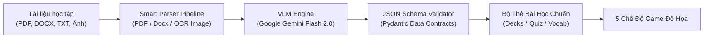
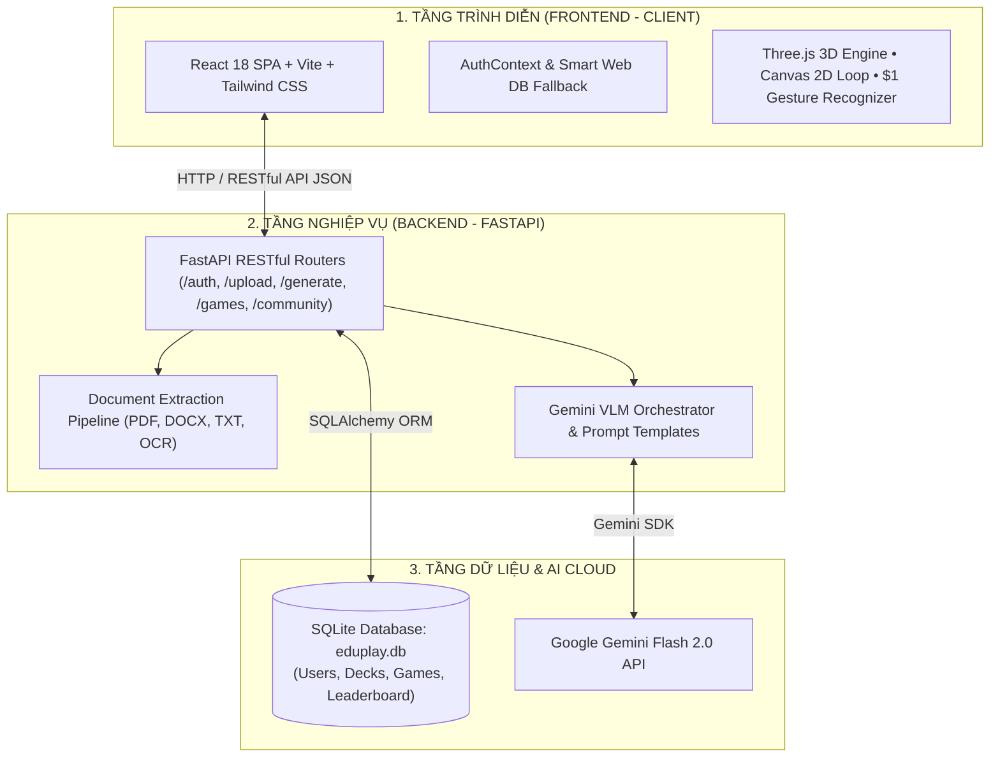
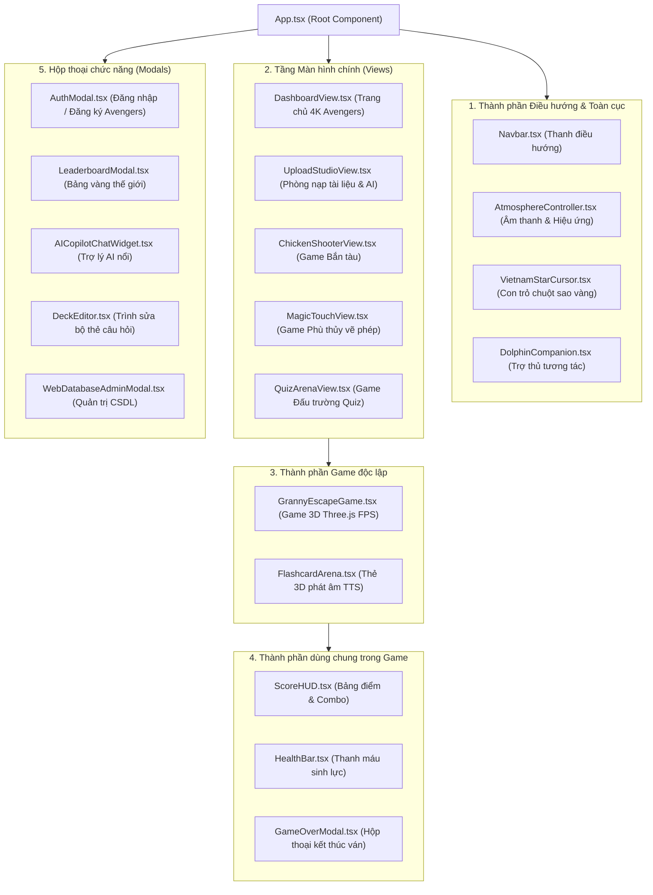
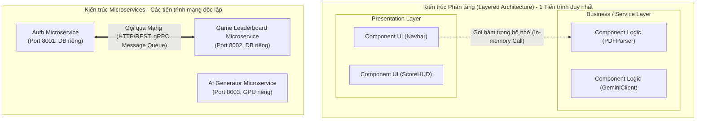

<div align="center">

# 🎮 EDUPLAY AI - NỀN TẢNG HỌC TẬP TRÒ CHƠI HÓA 4K & VLM MULTIMODAL
### *Gamified AI Learning Platform • Powered by Google Gemini & Three.js 3D*

[](https://vercel.com)
[](https://reactjs.org/)
[](https://www.typescriptlang.org/)
[](https://threejs.org/)
[](https://fastapi.tiangolo.com/)
[](https://ai.google.dev/)
[](LICENSE)

<br/>

> **EduPlay** là nền tảng giáo dục tương tác thế hệ mới, ứng dụng **Trí tuệ Nhân tạo Đa phương thức (Multimodal VLM)** và **Đồ họa 3D thời gian thực**. Hệ thống tự động phân tích mọi loại tài liệu học tập thô (sách giáo trình PDF, file Word DOCX, văn bản TXT, hình ảnh chụp bài giảng) để biến thành các **đấu trường trò chơi sinh động**, giúp nâng cao 300% khả năng ghi nhớ và tạo cảm hứng học tập bất tận.

[🌐 Trải Nghiệm Web Trực Tiếp](#-triển-khai-lên-web-deployment) • [✨ Tính Năng Nổi Bật](#-tính-năng-nổi-bật) • [🏗️ Kiến Trúc Hệ Thống](#-kiến-trúc-hệ-thống) • [🚀 Cài Đặt & Khởi Chạy](#-cài-đặt--khởi-chạy-nhanh) • [📚 Tài Liệu API](#-tài-liệu-api-endpoints)

---

</div>

## 📑 MỤC LỤC
1. [Giới thiệu Dự án](#-giới-thiệu-dự-án)
2. [5 Chế độ Trò chơi Độc quyền](#-5-chế-độ-trò-chơi-độc-quyền)
3. [Lõi Xử lý AI Đa Phương Thức (VLM Engine)](#-lõi-xử-lý-ai-đa-phương-thức-vlm-engine)
4. [Kiến Trúc Hệ Thống Chuyên Sâu (System Architecture)](#-kiến-trúc-hệ-thống)
   - 4.1. [Xác định loại kiến trúc đang sử dụng](#41-xác-định-loại-kiến-trúc-đang-sử-dụng)
   - 4.2. [Mô tả Components của Giao diện (Frontend Components)](#42-mô-tả-components-của-giao-diện-frontend-components)
   - 4.3. [Mô tả các Services trong Backend](#43-mô-tả-các-services-trong-backend)
   - 4.4. [Phân biệt Chuyên sâu: Service (Microservices) vs Component (Layered Architecture)](#44-phân-biệt-chuyên-sâu-service-microservices-vs-component-layered-architecture)
5. [Công Nghệ Sử Dụng (Tech Stack)](#-công-nghệ-sử-dụng-tech-stack)
6. [Cấu Trúc Thư Mục Chuẩn Hóa](#-cấu-trúc-thư-mục-chuẩn-hóa)
7. [Cài Đặt & Khởi Chạy Nhanh](#-cài-đặt--khởi-chạy-nhanh)
8. [Triển Khai Lên Web (Deployment)](#-triển-khai-lên-web-deployment)
9. [Tài Liệu API Endpoints](#-tài-liệu-api-endpoints)
10. [Bản Quyền & Tác Giả](#-bản-quyền--tác-giả)

---

## 🌟 GIỚI THIỆU DỰ ÁN

Hầu hết các nền tảng học tập trực tuyến hiện nay chỉ dừng lại ở các bài trắc nghiệm nhàm chán hoặc flashcard thụ động. **EduPlay** giải quyết triệt để vấn đề này bằng việc kết hợp giữa:
- **Gamification (Trò chơi hóa)**: Đưa kiến thức vào các thử thách phản xạ bàn phím, vẽ nét phép thuật cử chỉ, đấu trường trí tuệ và game sinh tồn 3D trốn thoát.
- **Multimodal AI Pipeline**: Đọc hiểu cấu trúc văn bản học thuật, tự động phát hiện từ vựng trọng tâm, sinh câu hỏi trắc nghiệm kèm giải thích logic bằng mô hình ngôn ngữ lớn **Google Gemini Flash 2.0**.
- **Cinematic Experience**: Giao diện chuẩn **4K Ultra-HD phong cách Siêu Anh Hùng Avengers**, hiệu ứng âm thanh sống động (Web Audio API), trợ lý ảo AI Copilot đồng hành 24/7.

---

## 🎮 5 CHẾ ĐỘ TRÒ CHƠI ĐỘC QUYỀN

| STT | Tựa Game | Công Nghệ Engine | Cơ Chế Học Tập & Tương Tác |
| :---: | :--- | :--- | :--- |
| **1** | **Granny 3D Escape Room** | **Three.js / React Three Fiber** | Game sinh tồn 3D góc nhìn thứ nhất (FPS). Người chơi phải giải các câu đố từ vựng để mở khóa cửa thoát hiểm trước khi bị Bà Ngoại bắt giữ. |
| **2** | **Doctor Strange Magic Touch** | **HTML5 Canvas 2D + $1 Gesture** | Quái vật bay trên các quả bóng mang ký tự. Người chơi dùng chuột hoặc vuốt cảm ứng để vẽ nét phép thuật, hệ thống nhận diện cử chỉ tức thời để phá hủy bóng bay. |
| **3** | **Iron Man Chicken Shooter** | **Custom 2D GameLoop 60 FPS** | Bắn tàu không gian luyện gõ từ vựng / Pinyin. Tàu chiến tự động khóa mục tiêu và bắn tia Laser hủy diệt quái vật khi người chơi gõ đúng phím. |
| **4** | **Stark Tech Speed Quiz Arena** | **React Animation + Audio FX** | Đấu trường trắc nghiệm đếm ngược 10 giây. Tích lũy Combo chuỗi thắng nhân điểm số x2, x3, x4 kèm phân tích đáp án chi tiết. |
| **5** | **Avengers Flashcard Arena** | **3D Flip Card + Speech TTS** | Lật thẻ ghi nhớ không gian 3D, hỗ trợ phát âm chuẩn bản xứ, tự động thống kê tỉ lệ thuộc bài và ghi nhớ ngắt quãng (Spaced Repetition). |

---

## 🧠 LÕI XỬ LÝ AI ĐA PHƯƠNG THỨC (VLM ENGINE)



- **Đa định dạng đầu vào**: Hỗ trợ bóc tách nội dung từ tài liệu PDF sách giáo khoa, file Word giáo án (`.docx`), file văn bản (`.txt`) và hình ảnh chụp bảng/sách thông qua thị giác máy tính OCR.
- **Trích xuất thông minh**: Tự động nhận diện ngữ cảnh môn học (Ngoại ngữ, Lịch sử, Khoa học, Công nghệ thông tin) và phân loại độ khó.
- **Dữ liệu chuẩn hóa**: Xuất dữ liệu dưới dạng JSON nghiêm ngặt (Câu hỏi, 4 phương án A-B-C-D, đáp án đúng, phân tích chuyên sâu).
- **Cơ chế Fallback thông minh**: Tự động chuyển sang bộ ngân hàng dữ liệu mẫu ngoại tuyến khi mất kết nối mạng hoặc không có API key.

---

## 🏗️ KIẾN TRÚC HỆ THỐNG

### 4.1. Xác định loại kiến trúc đang sử dụng

Dự án **EduPlay** kết hợp hai mô hình kiến trúc cốt lõi trong kỹ nghệ phần mềm hiện đại:

1. **Kiến trúc Tổng thể Hệ thống: Mô hình Khách - Chủ 3 tầng tách rời (Decoupled Client-Server / Modern 3-Tier Layered Architecture)**:
   - **Tầng 1 - Presentation Tier (Tầng trình diễn / Frontend)**: Ứng dụng Single Page Application (SPA) độc lập, xây dựng bằng **React 18 + TypeScript + Vite**, kết xuất giao diện và đồ họa thời gian thực trực tiếp trên trình duyệt máy khách.
   - **Tầng 2 - Application / Logic Tier (Tầng ứng dụng / Backend)**: RESTful API Server độc lập xây dựng bằng **FastAPI (Python)**, chịu trách nhiệm xử lý toàn bộ logic nghiệp vụ (xác thực danh tính, bóc tách tài liệu, điều phối AI, tính điểm và quản lý phòng chơi).
   - **Tầng 3 - Data & External Services Tier (Tầng dữ liệu và Dịch vụ ngoài)**:
     - Cơ sở dữ liệu quan hệ **SQLite** (`eduplay.db` qua SQLAlchemy ORM) và bộ nhớ Web Storage dự phòng.
     - Tích hợp dịch vụ đám mây ngoài: **Google Gemini Flash 2.0 API** (Mô hình Trí tuệ nhân tạo VLM đa phương thức).

2. **Kiến trúc Nội bộ Backend: Khối module hóa (Modular Monolith)**:
   - Toàn bộ các module chức năng (*Auth, Upload, Generate, Games, Chat, Admin*) được tổ chức thành các routers và services độc lập, nhưng **chạy chung trong một tiến trình FastAPI duy nhất (Single Runtime Process)** và chia sẻ chung một kết nối cơ sở dữ liệu `eduplay.db`.



---

### 4.2. Mô tả Components của Giao diện (Frontend Components)

Trong Frontend (`frontend/src`), các thành phần giao diện (Components) được phân chia theo cấu trúc phân cấp nghiêm ngặt nhằm đảm bảo tính tái sử dụng và dễ bảo trì:



#### Chi tiết 5 nhóm Component giao diện:
1. **Nhóm Điều hướng & Toàn cục (Navigation & Ambient)**:
   - `Navbar.tsx`: Hiển thị Logo, thanh chuyển Tab (Dashboard, Upload, Games, Leaderboard), bộ điều khiển nhạc, Avatar nhân vật và nút mở các cửa sổ modal.
   - `AtmosphereController.tsx` & `SoundSynthesizer.ts`: Quản lý không gian điện ảnh (nhạc nền, âm thanh Web Audio procedural).
   - `VietnamStarCursor.tsx`, `DolphinCompanion.tsx`: Các hiệu ứng hoạt họa tăng tính tương tác sinh động.
2. **Nhóm Màn hình chính (Views)**:
   - `DashboardView.tsx`: Trung tâm điều khiển hiển thị banner 4K Marvel, danh sách bộ thẻ học tập và lối tắt vào các màn chơi.
   - `UploadStudioView.tsx`: Giao diện kéo thả file học tập, khung dán văn bản và nút kích hoạt AI tạo bài học.
   - `ChickenShooterView.tsx`, `MagicTouchView.tsx`, `QuizArenaView.tsx`: Màn hình chứa Canvas trò chơi và bàn phím ảo.
3. **Nhóm Game 3D & Tương tác cao**:
   - `GrannyEscapeGame.tsx`: Render môi trường phòng giam 3D bằng **Three.js / React Three Fiber**, camera góc nhìn người thứ nhất (FPS), giải câu đố từ vựng để tìm chìa khóa thoát hiểm.
   - `FlashcardArena.tsx`: Thẻ học không gian 3D lật 2 mặt, tích hợp công nghệ Text-to-Speech (TTS) đọc từ vựng bản xứ.
4. **Nhóm Thành phần Game dùng chung (Game-Shared)**:
   - `ScoreHUD.tsx`: Hiển thị điểm số, chuỗi combo x2, x3, thời gian đếm ngược.
   - `HealthBar.tsx`: Hiển thị thanh máu trực quan.
   - `GameOverModal.tsx`: Hộp thoại vinh danh kết quả khi ván đấu kết thúc.
5. **Nhóm Hộp thoại Chức năng (Modals)**:
   - `AuthModal.tsx`: Đăng nhập, đăng ký với 8 Avatar Marvel, chọn tài khoản mẫu Tony Stark hoặc đăng nhập mạng xã hội.
   - `DeckEditor.tsx`: Cho phép chỉnh sửa câu hỏi, đáp án A-B-C-D trước khi lưu vào CSDL.
   - `AICopilotChatWidget.tsx`: Khung chat AI thu nhỏ luôn nổi ở góc màn hình để hỗ trợ học tập thời gian thực.
   - `WebDatabaseAdminModal.tsx`: Giao diện dành riêng cho Admin để xem và truy vấn các bảng CSDL.

---

### 4.3. Mô tả các Services trong Backend

Backend (`backend/app`) được phân tách thành các Service chuyên trách xử lý nghiệp vụ, đảm bảo nguyên lý đơn trách nhiệm (Single Responsibility Principle):

| Tên Nhóm Service | File mã nguồn | Vai trò & Chức năng chi tiết |
| :--- | :--- | :--- |
| **1. Parser Services** *(Dịch vụ Bóc tách Tài liệu)* | `pdf_parser.py`<br>`docx_parser.py`<br>`txt_parser.py`<br>`image_parser.py` | - `pdf_parser`: Dùng thư viện `pypdf` đọc sách giáo trình, tài liệu học thuật.<br>- `docx_parser`: Trích xuất nội dung văn bản, danh sách gạch đầu dòng từ file Word.<br>- `txt_parser`: Đọc text thuần, tự động nhận diện bảng mã tiếng Việt UTF-8.<br>- `image_parser`: Dùng Gemini Vision OCR nhận diện chữ in và chữ viết tay từ ảnh chụp. |
| **2. AI & Content Generator Services** *(Dịch vụ Trí tuệ Nhân tạo)* | `gemini_client.py`<br>`prompt_templates.py`<br>`content_generator.py`<br>`vlm_engine.py` | - `gemini_client`: Giao tiếp với Google Gemini Flash 2.0 API, ép kiểu đầu ra JSON Schema chuẩn.<br>- `prompt_templates`: Quản lý các mẫu Prompt chuyên biệt (sinh câu hỏi trắc nghiệm, trích xuất từ vựng trọng tâm).<br>- `content_generator`: Điều phối luồng xử lý AI, kiểm tra tính hợp lệ dữ liệu và tự động kích hoạt **Fallback Heuristic** (dùng dữ liệu mẫu) khi mất mạng.<br>- `vlm_engine`: Lõi xử lý đa phương thức kết hợp hình ảnh và ngữ cảnh học tập. |
| **3. Authentication & Security Services** *(Dịch vụ Xác thực & Bảo mật)* | `core/security.py`<br>`api/v1/auth.py`<br>`core/deps.py` | - Mã hóa mật khẩu người dùng bằng thuật toán một chiều `Bcrypt / Passlib`.<br>- Cấp phát, giải mã và xác thực chữ ký số **JWT (JSON Web Token)**.<br>- Middleware Dependency `get_current_user` kiểm tra phiên làm việc và phân quyền `user` / `admin`. |
| **4. Decks & Data Services** *(Dịch vụ Quản lý Bài học)* | `api/v1/decks.py`<br>`services/sample_data.py` | - Quản lý cấu trúc `LearningPackage` (gồm `QuizDeck` và `VocabularyDeck`).<br>- Cung cấp ngân hàng câu hỏi có sẵn (Tiếng Trung HSK1, Tiếng Anh CNTT) cho người dùng luyện tập ngay. |
| **5. Game Records & Leaderboard Services** *(Dịch vụ Điểm số & Xếp hạng)* | `api/v1/games.py` | - Lưu trữ lịch sử mỗi ván đấu: điểm số, độ chính xác (accuracy), chuỗi combo cao nhất.<br>- Tính toán và sắp xếp danh sách Top chiến binh toàn cầu trên Bảng vàng (Leaderboard). |
| **6. Web Database Admin Services** *(Dịch vụ Quản trị CSDL)* | `api/v1/admin_db.py` | - Trích xuất lược đồ (Schema) CSDL SQLite.<br>- Hỗ trợ phân trang, tìm kiếm, chỉnh sửa và xóa trực tiếp các bản ghi trong các bảng CSDL. |

---

### 4.4. Phân biệt Chuyên sâu: Service (Microservices) vs Component (Layered Architecture)

Đây là hai khái niệm nền tảng nhưng nằm ở **hai cấp độ kiến trúc hoàn toàn khác nhau**:



#### Bảng so sánh 8 tiêu chí chuyên sâu:

| Tiêu chí so sánh | Component (trong Kiến trúc Phân tầng - Layered) | Service (trong Kiến trúc Microservices) |
| :--- | :--- | :--- |
| **1. Bản chất (Definition)** | Là một **đơn vị cấu thành code** (file, class, function, module) nằm bên trong một tầng của ứng dụng. | Là một **ứng dụng/tiến trình phần mềm hoàn chỉnh và độc lập** (autonomous process) phục vụ một nghiệp vụ riêng biệt. |
| **2. Không gian chạy (Runtime Process)** | Chạy **trong cùng một tiến trình (In-Process)**. Chia sẻ chung không gian bộ nhớ RAM, CPU với toàn bộ ứng dụng. | Chạy trên **các tiến trình riêng biệt (Out-of-Process)**. Mỗi Service đóng gói trong container riêng (Docker), chạy trên server riêng. |
| **3. Cơ chế giao tiếp (Communication)** | Giao tiếp thông qua **lời gọi hàm trực tiếp trong RAM (In-Memory Function/Method Call)**. Tốc độ cực nhanh tính bằng nano-giây, không có độ trễ mạng. | Giao tiếp thông qua **Giao thức mạng (Network Protocols)** như HTTP/REST, gRPC, WebSocket hoặc Message Broker (RabbitMQ, Kafka). Có độ trễ mạng và nguy cơ mất kết nối. |
| **4. Cơ sở dữ liệu (Database)** | **Chia sẻ chung một CSDL (Shared Database)**. Mọi Component trong tầng Business Logic đều thao tác với cùng một cơ sở dữ liệu. | Tuân theo nguyên tắc **Database-per-Service**: Mỗi Service sở hữu CSDL riêng biệt, không service nào được truy cập trực tiếp vào CSDL của service khác. |
| **5. Triển khai (Deployment)** | **Đồng loạt (Monolithic/Atomic Deploy)**: Khi sửa 1 Component, bắt buộc phải build và deploy lại toàn bộ ứng dụng. | **Độc lập (Independent Deployability)**: Mỗi Service có quy trình CI/CD riêng, có thể cập nhật Service A mà không ảnh hưởng tới Service B. |
| **6. Khả năng mở rộng (Scalability)** | Phải nhân bản (scale) **toàn bộ ứng dụng**, không thể chỉ scale riêng một component tốn tài nguyên. | **Co giãn linh hoạt (Granular Scaling)**: Service nào chịu tải nặng (ví dụ Service Xử lý AI) có thể được cấp riêng nhiều RAM/GPU mà không lãng phí tài nguyên cho các service khác. |
| **7. Ranh giới công nghệ (Technology)** | Bị ràng buộc trong **cùng một ngôn ngữ lập trình** của cả tầng đó (ví dụ toàn bộ Backend viết bằng Python). | **Đa ngôn ngữ (Polyglot)**: Service A có thể viết bằng Python, Service B bằng Go, Service C bằng Node.js tùy theo đặc thù. |
| **8. Ví dụ thực tế trong dự án EduPlay** | - `pdf_parser.py`, `gemini_client.py` là các **Component** thuộc tầng Business Logic của Backend.<br>- `Navbar.tsx`, `ScoreHUD.tsx` là các **Component** thuộc tầng Presentation của Frontend. | Nếu ta tách phần xử lý `AI Generator` ra thành một server độc lập chạy ở cổng 9000, có database riêng và giao tiếp với Backend chính qua gRPC, lúc đó nó mới trở thành một **Microservice**. |

---

## 💻 CÔNG NGHỆ SỬ DỤNG (TECH STACK)

| Phân tầng | Công nghệ cốt lõi | Chi tiết tính năng |
| :--- | :--- | :--- |
| **Frontend** | **React 18**, **TypeScript**, **Vite** | Single Page Application tốc độ cao, quản lý State tập trung bằng React Hooks & Context. |
| **Đồ họa & Hiệu ứng** | **Three.js**, **React Three Fiber**, **Tailwind CSS** | Kết xuất 3D không gian, ánh sáng động thời gian thực, hiệu ứng hạt Particle và hoạt ảnh Framer Motion. |
| **Game Engine** | **HTML5 Canvas 2D**, **Web Audio API** | Vòng lặp trò chơi độc lập FPS, thuật toán nhận dạng nét vẽ `$1 Unistroke`, âm thanh tổng hợp đa âm sắc. |
| **Backend API** | **FastAPI (Python 3.10+)**, **Uvicorn** | Máy chủ bất đồng bộ ASGI (async/await), Pydantic validation, chuẩn RESTful JSON. |
| **Trí tuệ nhân tạo (AI)** | **Google Gemini Flash 2.0 API** | Vision-Language Model thế hệ mới, đọc hiểu văn bản và ảnh chụp bài giảng. |
| **Cơ sở dữ liệu** | **SQLite (SQLAlchemy ORM) & LocalStorage DB** | Lưu trữ người dùng, mật khẩu mã hóa bcrypt, bộ câu hỏi, lịch sử ván chơi và bảng xếp hạng. |
| **Bảo mật** | **JWT (JSON Web Token)**, **Passlib Bcrypt** | Xác thực phân quyền Người dùng (User) và Quản trị viên (Admin). |
| **Triển khai (Deploy)** | **Vercel**, **Git Version Control** | Triển khai web 1-click, tự động build SPA với tệp cấu hình tối ưu. |

---

## 📁 CẤU TRÚC THƯ MỤC CHUẨN HÓA

```
M:\Game/
├── frontend/                            # Ứng dụng Client (React 18 + Vite)
│   ├── public/assets/                   # Ảnh nền 4K, texture 3D, âm thanh
│   ├── src/
│   │   ├── components/                  # Giao diện tái sử dụng
│   │   │   ├── admin/                   # WebDatabaseAdminModal (Quản trị CSDL)
│   │   │   ├── auth/                    # AuthModal, Leaderboard, UserProfileMenu
│   │   │   ├── chat/                    # AICopilotChatWidget (Trợ lý AI nổi)
│   │   │   ├── games/                   # GrannyEscapeGame (3D), FlashcardArena
│   │   │   └── upload/                  # DocumentUpload, DeckEditor
│   │   ├── context/                     # AuthContext (Xác thực & phân quyền)
│   │   ├── games/                       # Lõi Game Engines độc lập
│   │   │   ├── chicken-shooter/         # Bắn tàu không gian luyện gõ
│   │   │   ├── magic-touch/             # Vẽ phép diệt quái (Gesture Recognizer)
│   │   │   └── common/                  # GameLoop, ParticleEngine, SoundSynthesizer
│   │   ├── lib/api.ts                   # Tầng API Client tích hợp Web Database Fallback
│   │   └── views/                       # Dashboard, UploadStudio, Game Arenas
│   ├── package.json                     # Quản lý dependencies frontend
│   └── vercel.json                      # Cấu hình rewrite URL cho Vercel SPA
│
├── backend/                             # Máy chủ API (Python FastAPI)
│   ├── app/
│   │   ├── api/v1/                      # Endpoints: auth, upload, generate, games, admin
│   │   ├── core/                        # Cấu hình bảo mật JWT, dependencies
│   │   ├── db/                          # Models SQLAlchemy, khởi tạo CSDL
│   │   ├── models/                      # Pydantic Schemas
│   │   └── services/                    # Parsers tài liệu (PDF, Word, OCR) & AI Generator
│   ├── eduplay.db                       # Cơ sở dữ liệu SQLite
│   └── requirements.txt                 # Thư viện Python Backend
│
├── sample_files/                        # Tài liệu bài học mẫu để test hệ thống
├── start_all.bat                        # Script khởi chạy 1-Click toàn bộ Frontend & Backend
├── package.json                         # Root build script hỗ trợ Vercel
├── vercel.json                          # Root Vercel routing configuration
└── README.md                            # Tài liệu dự án chính thức
```

---

## 🚀 CÀI ĐẶT & KHỞI CHẠY NHANH

### Yêu cầu môi trường:
- **Node.js**: Phiên bản 18.x trở lên.
- **Python**: Phiên bản 3.10 trở lên.
- **Trình duyệt**: Google Chrome, Microsoft Edge, Firefox (khuyên dùng trình duyệt hỗ trợ WebGL để chơi mượt 3D).

---

### Cách 1: Khởi động tự động 1-Click (Dành cho Windows)
Chỉ cần nhấp đúp chuột vào file:
```cmd
start_all.bat
```
Hệ thống sẽ tự động bật 2 cửa sổ song song:
1. **Backend FastAPI**: Đang chạy tại `http://localhost:8000` (kèm tài liệu tương tác tại `http://localhost:8000/docs`).
2. **Frontend React**: Đang chạy tại `http://localhost:5173`.
Trình duyệt sẽ tự động mở trang web EduPlay sẵn sàng để bạn trải nghiệm!

---

### Cách 2: Khởi động thủ công bằng dòng lệnh

#### 1. Khởi chạy Backend:
```bash
cd backend
python -m venv venv
venv\Scripts\activate       # Trên Windows (hoặc: source venv/bin/activate trên Mac/Linux)
pip install -r requirements.txt
python -m uvicorn app.main:app --host 127.0.0.1 --port 8000 --reload
```

#### 2. Khởi chạy Frontend:
Mở một cửa sổ dòng lệnh mới:
```bash
cd frontend
npm install
npm run dev
```
Truy cập đường dẫn: **`http://localhost:5173`**

---

## 🌐 TRIỂN KHAI LÊN WEB (DEPLOYMENT)

Hệ thống đã được thiết lập sẵn sàng để triển khai lên nền tảng đám mây **Vercel** chỉ trong 3 bước:

1. Đăng nhập vào [Vercel](https://vercel.com) bằng tài khoản GitHub của bạn.
2. Bấm **"Add New..."** ➔ Chọn **"Project"** ➔ Chọn repository **`Game`**.
3. Cấu hình cài đặt:
   - **Framework Preset**: Chọn **Vite**.
   - **Root Directory**: Chọn thư mục `frontend` (hoặc giữ nguyên thư mục gốc `./` vì dự án đã có cấu hình root `vercel.json` tự động).
   - Bấm **"Deploy"**.
4. Sau 1 phút, bạn sẽ nhận được đường link web trực tuyến có định dạng:
   👉 `https://game-eduplay.vercel.app` (Mở được trên cả máy tính lẫn điện thoại di động).

> 💡 **Lưu ý**: Nhờ cơ chế **Web Database Fallback**, khi chạy trên Vercel dù không có server Python Backend, người dùng vẫn có thể **Đăng ký tài khoản mới**, **Đăng nhập mẫu với Tony Stark**, **Chơi toàn bộ 5 mini-game** và **Lưu điểm số** hoàn toàn trơn tru!

---

## 📚 TÀI LIỆU API ENDPOINTS

Hệ thống cung cấp hệ thống API RESTful toàn diện, có thể kiểm thử trực tiếp qua Swagger UI tại `http://localhost:8000/docs`:

### Nhóm Xác Thực & Người Dùng (`/api/v1/auth`)
- `POST /api/v1/auth/register`: Đăng ký tài khoản người chơi mới.
- `POST /api/v1/auth/login`: Đăng nhập bằng Username/Email và nhận JWT Bearer Token.
- `GET /api/v1/auth/me`: Lấy thông tin hồ sơ tài khoản hiện tại.
- `PUT /api/v1/auth/profile`: Cập nhật tên hiển thị hoặc Avatar Siêu Anh Hùng.

### Nhóm Tải Lên & Tạo Sinh AI (`/api/v1/`)
- `POST /api/v1/upload`: Tải lên tài liệu PDF, DOCX, TXT hoặc ảnh chụp bài giảng để trích xuất nội dung thô.
- `POST /api/v1/generate`: Gửi văn bản bài học đến Gemini Flash 2.0 để sinh bộ câu hỏi và từ vựng tự động.
- `GET /api/v1/decks`: Lấy danh sách toàn bộ các bộ bài học trong hệ thống.
- `POST /api/v1/decks`: Lưu một bộ bài học tùy chỉnh mới vào CSDL.

### Nhóm Trò Chơi & Xếp Hạng (`/api/v1/games`)
- `POST /api/v1/games/record`: Lưu trữ kết quả ván chơi, độ chính xác và chuỗi combo.
- `GET /api/v1/games/leaderboard`: Lấy danh sách Top chiến binh đạt điểm cao nhất toàn cầu.

### Nhóm Quản Trị CSDL (`/api/v1/admin/db`)
- `GET /api/v1/admin/db/tables`: Xem tổng quan cấu trúc và số lượng bản ghi các bảng trong CSDL.
- `GET /api/v1/admin/db/table/{table_name}`: Xem chi tiết dữ liệu bảng kèm tính năng phân trang và tìm kiếm.

---

## 👨‍💻 BẢN QUYỀN & TÁC GIẢ

- **Đơn vị phát triển**: Dự án Nghiên Cứu & Phát Triển Ứng Dụng Giáo Dục Thông Minh (EduPlay Team).
- **Tác giả / Lead Developer**: [bangmanhbac-max](https://github.com/bangmanhbac-max)
- **Giấy phép bản quyền**: Phát hành theo giấy phép mã nguồn mở [MIT License](LICENSE).

<div align="center">
  <sub>Xây dựng với tất cả niềm đam mê công nghệ giáo dục và trí tuệ nhân tạo ❤️ 2026</sub>
</div>
