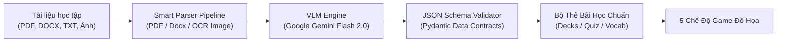
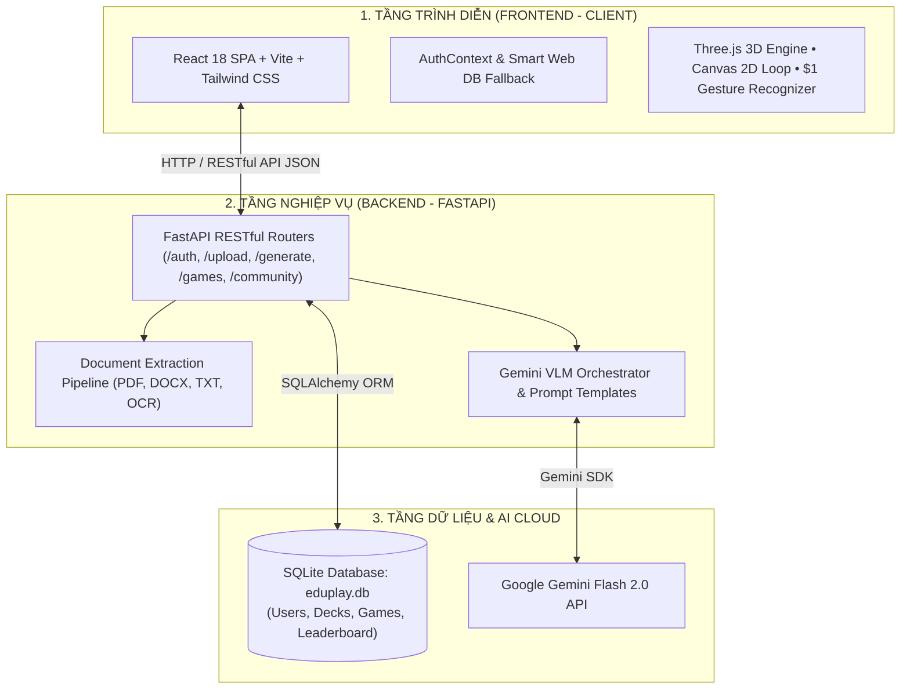
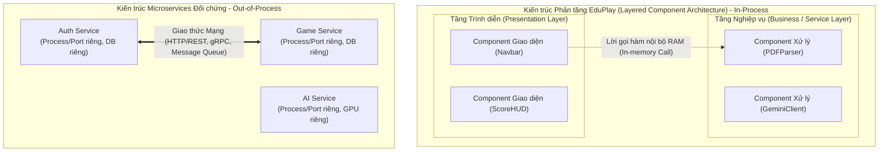
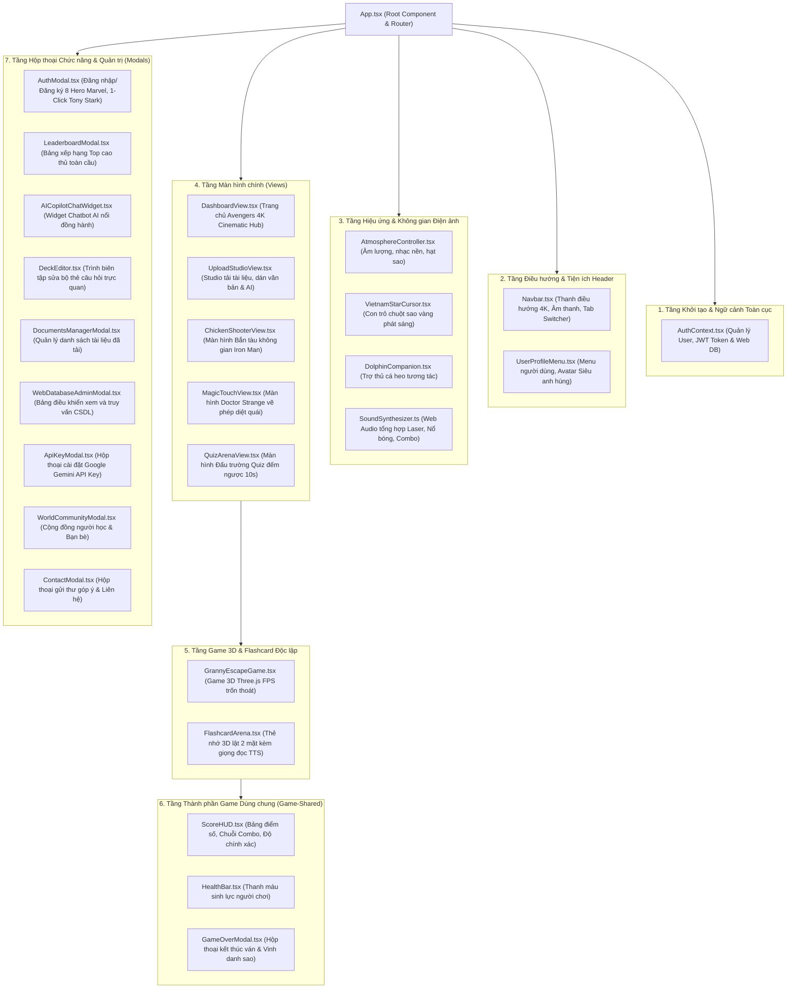

<div align="center">

# 🎮 EDUPLAY AI - NỀN TẢNG HỌC TẬP TRÒ CHƠI HÓA 4K & VLM MULTIMODAL
### *Gamified AI Learning Platform • Powered by Google Gemini & Three.js 3D*

[](https://vercel.com)
[](https://reactjs.org/)
[](https://www.typescriptlang.org/)
[](https://threejs.org/)
[](https://fastapi.tiangolo.com/)
[](https://ai.google.dev/)
[](LICENSE)

<br/>

> **EduPlay** là nền tảng giáo dục tương tác thế hệ mới, ứng dụng **Trí tuệ Nhân tạo Đa phương thức (Multimodal VLM)** và **Đồ họa 3D thời gian thực**. Hệ thống tự động phân tích mọi loại tài liệu học tập thô (sách giáo trình PDF, file Word DOCX, văn bản TXT, hình ảnh chụp bài giảng) để biến thành các **đấu trường trò chơi sinh động**, giúp nâng cao 300% khả năng ghi nhớ và tạo cảm hứng học tập bất tận.

[🌐 Trải Nghiệm Web Trực Tiếp](#-triển-khai-lên-web-deployment) • [✨ 5 Chế Độ Game](#-5-chế-độ-trò-chơi-độc-quyền) • [🏗️ Kiến Trúc Hệ Thống](#-kiến-trúc-và-thiết-kế-hệ-thống) • [🚀 Cài Đặt & Khởi Chạy](#-cài-đặt--khởi-chạy-nhanh) • [📚 Tài Liệu API](#-tài-liệu-api-endpoints)

---

</div>

## 📑 MỤC LỤC
1. [Giới thiệu Dự án](#-giới-thiệu-dự-án)
2. [5 Chế độ Trò chơi Độc quyền](#-5-chế-độ-trò-chơi-độc-quyền)
3. [Lõi Xử lý AI Đa Phương Thức (VLM Engine)](#-lõi-xử-lý-ai-đa-phương-thức-vlm-engine)
4. [Kiến Trúc và Thiết Kế Hệ Thống (System Architecture)](#-kiến-trúc-và-thiết-kế-hệ-thống)
   - 4.1. [Mô hình Kiến trúc Tổng thể: 3-Tier Decoupled Architecture](#41-mô-hình-kiến-trúc-tổng-thể-3-tier-decoupled-architecture)
   - 4.2. [Định vị Thiết kế: Kiến trúc Phân tầng (Layered) vs Microservices](#42-định-vị-thiết-kế-kiến-trúc-phân-tầng-layered-vs-microservices)
   - 4.3. [Đặc tả Toàn diện Tầng Giao diện (Frontend Component Architecture)](#43-đặc-tả-toàn-diện-tầng-giao-diện-frontend-component-architecture)
   - 4.4. [Đặc tả Tầng Dịch vụ Xử lý Nghiệp vụ Backend (Backend Service Architecture)](#44-đặc-tả-tầng-dịch-vụ-xử-lý-nghiệp-vụ-backend-backend-service-architecture)
   - 4.5. [Bảng Ma trận Đối chiếu Kỹ thuật: Layered Components vs Distributed Microservices](#45-bảng-ma-trận-đối-chiếu-kỹ-thuật-layered-components-vs-distributed-microservices)
5. [Công Nghệ Sử Dụng (Tech Stack)](#-công-nghệ-sử-dụng-tech-stack)
6. [Cấu Trúc Thư Mục Chuẩn Hóa](#-cấu-trúc-thư-mục-chuẩn-hóa)
7. [Cài Đặt & Khởi Chạy Nhanh](#-cài-đặt--khởi-chạy-nhanh)
8. [Triển Khai Lên Web (Deployment)](#-triển-khai-lên-web-deployment)
9. [Tài Liệu API Endpoints](#-tài-liệu-api-endpoints)
10. [Bản Quyền & Tác Giả](#-bản-quyền--tác-giả)

---

## 🌟 GIỚI THIỆU DỰ ÁN

Hầu hết các nền tảng học tập trực tuyến hiện nay chỉ dừng lại ở các bài trắc nghiệm nhàm chán hoặc flashcard thụ động. **EduPlay** giải quyết triệt để vấn đề này bằng việc kết hợp giữa:
- **Gamification (Trò chơi hóa)**: Đưa kiến thức vào các thử thách phản xạ bàn phím, vẽ nét phép thuật cử chỉ, đấu trường trí tuệ và game sinh tồn 3D trốn thoát.
- **Multimodal AI Pipeline**: Đọc hiểu cấu trúc văn bản học thuật, tự động phát hiện từ vựng trọng tâm, sinh câu hỏi trắc nghiệm kèm giải thích logic bằng mô hình ngôn ngữ lớn **Google Gemini Flash 2.0**.
- **Cinematic Experience**: Giao diện chuẩn **4K Ultra-HD phong cách Siêu Anh Hùng Avengers**, hiệu ứng âm thanh sống động (Web Audio API), trợ lý ảo AI Copilot đồng hành 24/7.

---

## 🎮 5 CHẾ ĐỘ TRÒ CHƠI ĐỘC QUYỀN

| STT | Tựa Game | Công Nghệ Engine | Cơ Chế Học Tập & Tương Tác |
| :---: | :--- | :--- | :--- |
| **1** | **Granny 3D Escape Room** | **Three.js / React Three Fiber** | Game sinh tồn 3D góc nhìn thứ nhất (FPS). Người chơi phải giải các câu đố từ vựng để mở khóa cửa thoát hiểm trước khi bị Bà Ngoại bắt giữ. |
| **2** | **Doctor Strange Magic Touch** | **HTML5 Canvas 2D + $1 Gesture** | Quái vật bay trên các quả bóng mang ký tự. Người chơi dùng chuột hoặc vuốt cảm ứng để vẽ nét phép thuật, hệ thống nhận diện cử chỉ tức thời để phá hủy bóng bay. |
| **3** | **Iron Man Chicken Shooter** | **Custom 2D GameLoop 60 FPS** | Bắn tàu không gian luyện gõ từ vựng / Pinyin. Tàu chiến tự động khóa mục tiêu và bắn tia Laser hủy diệt quái vật khi người chơi gõ đúng phím. |
| **4** | **Stark Tech Speed Quiz Arena** | **React Animation + Audio FX** | Đấu trường trắc nghiệm đếm ngược 10 giây. Tích lũy Combo chuỗi thắng nhân điểm số x2, x3, x4 kèm phân tích đáp án chi tiết. |
| **5** | **Avengers Flashcard Arena** | **3D Flip Card + Speech TTS** | Lật thẻ ghi nhớ không gian 3D, hỗ trợ phát âm chuẩn bản xứ, tự động thống kê tỉ lệ thuộc bài và ghi nhớ ngắt quãng (Spaced Repetition). |

---

## 🧠 LÕI XỬ LÝ AI ĐA PHƯƠNG THỨC (VLM ENGINE)



- **Đa định dạng đầu vào**: Hỗ trợ bóc tách nội dung từ tài liệu PDF sách giáo khoa, file Word giáo án (`.docx`), file văn bản (`.txt`) và hình ảnh chụp bảng/sách thông qua thị giác máy tính OCR.
- **Trích xuất thông minh**: Tự động nhận diện ngữ cảnh môn học (Ngoại ngữ, Lịch sử, Khoa học, Công nghệ thông tin) và phân loại độ khó.
- **Dữ liệu chuẩn hóa**: Xuất dữ liệu dưới dạng JSON nghiêm ngặt (Câu hỏi, 4 phương án A-B-C-D, đáp án đúng, phân tích chuyên sâu).
- **Cơ chế Fallback thông minh**: Tự động chuyển sang bộ ngân hàng dữ liệu mẫu ngoại tuyến khi mất kết nối mạng hoặc không có API key.

---

## 🏗️ KIẾN TRÚC VÀ THIẾT KẾ HỆ THỐNG

### 4.1. Mô hình Kiến trúc Tổng thể: 3-Tier Decoupled Architecture

Hệ thống **EduPlay** được thiết kế dựa trên nguyên lý **Phân tách Trách nhiệm (Separation of Concerns)** theo mô hình **Kiến trúc Phân tầng 3 Tầng Hiện Đại (Modern 3-Tier Decoupled Layered Architecture)**:

- **Tầng Trình Diễn (Presentation Tier - Client)**: Xây dựng độc lập dưới dạng Single Page Application (SPA) bằng **React 18**, **TypeScript** và **Vite**. Tầng này chịu trách nhiệm hiển thị giao diện, tiếp nhận tương tác người dùng, quản lý hoạt ảnh và render đồ họa thời gian thực (Three.js 3D và Canvas 2D).
- **Tầng Nghiệp Vụ (Application / Logic Tier - Server)**: Được đóng gói dưới dạng RESTful API Server bằng **FastAPI (Python)**, vận hành trên nền tảng máy chủ bất đồng bộ Uvicorn ASGI Server. Tầng này chịu trách nhiệm điều phối toàn bộ nghiệp vụ (Business Logic): xác thực bảo mật JWT, xử lý pipeline trích xuất tài liệu, tích hợp trí tuệ nhân tạo và tính toán kết quả xếp hạng.
- **Tầng Dữ Liệu & Dịch Vụ Đám Mây (Data & Cloud Service Tier)**: Quản lý tính bền vững của dữ liệu thông qua cơ sở dữ liệu quan hệ **SQLite** (sử dụng SQLAlchemy ORM) kết hợp cơ chế Web Database Storage dự phòng trên trình duyệt; đồng thời tích hợp dịch vụ trí tuệ nhân tạo ngoại vi **Google Gemini Flash 2.0 API**.



---

### 4.2. Định vị Thiết kế: Kiến trúc Phân tầng (Layered) vs Microservices

Về mặt bản chất kỹ thuật phần mềm, hệ thống EduPlay được thiết kế và triển khai theo mô hình **Kiến trúc Phân tầng dựa trên Thành phần (Component-based Layered Architecture / Modular Monolith)**, hoàn toàn khác biệt với mô hình Dịch vụ Siêu nhỏ phân tán (Distributed Microservices).

Thiết kế kiến trúc này được định hình bởi 4 đặc tính công nghệ cốt lõi:

1. **Môi trường thực thi đơn tiến trình (In-Process Monolithic Runtime)**:
   Toàn bộ máy chủ Backend vận hành trong **cùng một tiến trình máy chủ duy nhất** (`uvicorn app.main:app`). Toàn bộ các module nghiệp vụ như Xác thực, Bóc tách tài liệu, Tạo sinh AI, Quản lý bài học và Bảng xếp hạng đều được tải vào chung một không gian địa chỉ bộ nhớ (RAM) và chia sẻ cùng tiến trình CPU, không bị phân tách thành các tiến trình/container độc lập qua mạng.
2. **Cơ chế giao tiếp nội bộ qua Lời gọi hàm (In-Memory Function Calls)**:
   Các thành phần trong Backend tương tác trực tiếp với nhau thông qua lời gọi hàm/phương thức nội bộ trong RAM (In-Memory Python class/function calls) với độ trễ cực thấp (nano-giây), không phát sinh chi phí truyền tải qua mạng (Network Latency) hay rủi ro đứt gãy kết nối mạng giữa các dịch vụ.
3. **Mô hình Dữ liệu Tập trung Dùng chung (Centralized Shared Database)**:
   Mọi thành phần nghiệp vụ của Backend đều kết nối và thao tác đồng nhất trên **một cơ sở dữ liệu quan hệ duy nhất** (`eduplay.db`), đảm bảo tính toàn vẹn giao dịch (ACID) mà không cần triển khai các mô hình quản lý phân tán phức tạp như Two-Phase Commit hay Saga Pattern của kiến trúc Microservices.
4. **Cấu trúc Giao diện Hướng Thành phần (Component-Driven Frontend)**:
   Phía Client được tổ chức theo cấu trúc phân tầng nghiêm ngặt: *Presentation Layer (React Components)* ➔ *State Management Layer (AuthContext, Game Hooks)* ➔ *Data Access Layer (API Client)* ➔ *Network Layer*.



---

### 4.3. Đặc tả Toàn diện Tầng Giao diện (Frontend Component Architecture)

Toàn bộ giao diện người dùng được module hóa thành các **Components** độc lập, có khả năng tái sử dụng cao, phân bố theo cây phân cấp thành phần (Component Hierarchy Tree):



#### Bảng danh mục đặc tả chi tiết các Components giao diện:

| Phân Nhóm Component | Tên File / Module | Chức Năng Kỹ Thuật & Nghiệp Vụ |
| :--- | :--- | :--- |
| **Khởi tạo & Ngữ cảnh** | `App.tsx`<br>`AuthContext.tsx` | - `App.tsx`: Thành phần gốc điều phối trạng thái Tab hiển thị, nạp dữ liệu bài học toàn cục.<br>- `AuthContext.tsx`: Quản lý phiên làm việc, lưu trữ JWT Token và tự động kích hoạt Web Database Fallback khi chạy trên Vercel. |
| **Điều hướng & Header** | `Navbar.tsx`<br>`UserProfileMenu.tsx` | - `Navbar.tsx`: Thanh điều hướng trung tâm phong cách Cyberpunk 4K, hỗ trợ chuyển Tab, chỉnh âm lượng và mở các Modal.<br>- `UserProfileMenu.tsx`: Menu thả xuống quản lý thông tin tài khoản, cấp bậc chiến binh và thay đổi Avatar Siêu Anh Hùng. |
| **Hiệu ứng & Âm thanh** | `AtmosphereController.tsx`<br>`VietnamStarCursor.tsx`<br>`DolphinCompanion.tsx`<br>`SoundSynthesizer.ts` | - `AtmosphereController.tsx`: Đồng bộ hóa nhạc nền và nhịp điệu ánh sáng môi trường.<br>- `VietnamStarCursor.tsx`: Con trỏ chuột tùy biến hình ngôi sao vàng phát vệt sáng.<br>- `DolphinCompanion.tsx`: Trợ thủ cá heo 3D tương tác, khích lệ khi đạt chuỗi Combo.<br>- `SoundSynthesizer.ts`: Bộ tổng hợp âm thanh số bằng Web Audio API thuần, phát sinh âm thanh Laser, nổ bóng, tiếng vỗ tay mà không cần tải file mp3. |
| **Màn hình chính (Views)** | `DashboardView.tsx`<br>`UploadStudioView.tsx`<br>`ChickenShooterView.tsx`<br>`MagicTouchView.tsx`<br>`QuizArenaView.tsx` | - `DashboardView.tsx`: Banner điện ảnh 4K, thống kê tiến độ học tập và cổng vào 5 chế độ chơi.<br>- `UploadStudioView.tsx`: Khu vực tải tài liệu PDF, DOCX, Ảnh chụp OCR hoặc dán văn bản để AI phân tích.<br>- `ChickenShooterView.tsx`: Màn hình chứa GameLoop bắn tàu vũ trụ 60 FPS kết hợp bàn phím gõ từ vựng.<br>- `MagicTouchView.tsx`: Màn hình chứa Canvas 2D nhận dạng cử chỉ nét vẽ diệt quái.<br>- `QuizArenaView.tsx`: Màn hình thi đấu trắc nghiệm đếm ngược 10 giây với hiệu ứng Combo bùng nổ. |
| **Game 3D & Flashcard** | `GrannyEscapeGame.tsx`<br>`FlashcardArena.tsx` | - `GrannyEscapeGame.tsx`: Kết xuất không gian phòng giam 3D thời gian thực bằng **Three.js** và `@react-three/fiber`, camera FPS góc nhìn thứ nhất, giải câu đố từ vựng để mở cổng thoát hiểm.<br>- `FlashcardArena.tsx`: Thẻ học không gian 3D lật mặt mượt mà, tích hợp Text-to-Speech (TTS) phát âm chuẩn bản xứ, hỗ trợ lặp lại ngắt quãng (Spaced Repetition). |
| **Thành phần Game dùng chung** | `ScoreHUD.tsx`<br>`HealthBar.tsx`<br>`GameOverModal.tsx` | - `ScoreHUD.tsx`: Hiển thị điểm số, cấp độ nhân điểm (x1 -> x4), thời gian còn lại.<br>- `HealthBar.tsx`: Thanh máu sinh lực có hiệu ứng rung lắc (screen shake) khi nhận sát thương.<br>- `GameOverModal.tsx`: Hộp thoại tổng kết ván chơi hiển thị số từ đã thuộc, độ chính xác (%) và số sao vinh danh. |
| **Hộp thoại Chức năng & Quản trị** | `AuthModal.tsx`<br>`LeaderboardModal.tsx`<br>`AICopilotChatWidget.tsx`<br>`DeckEditor.tsx`<br>`DocumentsManagerModal.tsx`<br>`WebDatabaseAdminModal.tsx`<br>`ApiKeyModal.tsx`<br>`WorldCommunityModal.tsx`<br>`ContactModal.tsx` | - `AuthModal.tsx`: Đăng nhập/đăng ký với 8 nhân vật Marvel, nút *"Điền tài khoản mẫu (Tony Stark)"* 1-click, hỗ trợ OAuth.<br>- `LeaderboardModal.tsx`: Bảng vàng xếp hạng Top cao thủ toàn cầu.<br>- `AICopilotChatWidget.tsx`: Khung chat thu nhỏ nổi ở góc màn hình, gia sư AI giải đáp thắc mắc 24/7.<br>- `DeckEditor.tsx`: Cho phép chỉnh sửa câu hỏi, đáp án A-B-C-D và lời giải thích.<br>- `DocumentsManagerModal.tsx`: Quản lý danh sách các file tài liệu đã tải lên.<br>- `WebDatabaseAdminModal.tsx`: Giao diện Admin quản trị và truy vấn CSDL SQLite trực quan.<br>- `ApiKeyModal.tsx`, `WorldCommunityModal.tsx`, `ContactModal.tsx`: Cấu hình API key, kết bạn và liên hệ hỗ trợ. |

---

### 4.4. Đặc tả Tầng Dịch vụ Xử lý Nghiệp vụ Backend (Backend Service Architecture)

Toàn bộ các quy trình xử lý dữ liệu và logic nghiệp vụ phía Backend được tổ chức thành các **Services** nội bộ chuyên trách, phân bố theo từng phân hệ chức năng:

| Nhóm Dịch Vụ Nghiệp Vụ | File Mã Nguồn | Chức Năng Kỹ Thuật Chi Tiết |
| :--- | :--- | :--- |
| **Dịch vụ Bóc tách Tài liệu (Parser Services)** | `base_parser.py`<br>`pdf_parser.py`<br>`docx_parser.py`<br>`txt_parser.py`<br>`image_parser.py` | - `base_parser.py`: Định nghĩa Interface trừu tượng `BaseParser` chuẩn hóa phương thức bóc tách.<br>- `pdf_parser.py`: Sử dụng thư viện `pypdf` bóc tách cấu trúc phân trang của sách giáo trình PDF.<br>- `docx_parser.py`: Sử dụng `python-docx` đọc hiểu văn bản, danh sách gạch đầu dòng trong tài liệu Word.<br>- `txt_parser.py`: Đọc file văn bản thuần, tự động nhận diện bảng mã UTF-8 tiếng Việt.<br>- `image_parser.py`: Tích hợp Gemini Vision OCR nhận diện chữ in và chữ viết tay từ ảnh chụp bài giảng. |
| **Dịch vụ Trí tuệ Nhân tạo (AI & VLM Services)** | `gemini_client.py`<br>`prompt_templates.py`<br>`content_generator.py`<br>`vlm_engine.py` | - `gemini_client.py`: Quản lý kết nối Google Gemini Flash 2.0 API, thiết lập cấu hình tham số sinh và ép kiểu đầu ra JSON Schema chuẩn.<br>- `prompt_templates.py`: Kho lưu trữ System Prompt kỹ thuật tối ưu hóa cho từng môn học.<br>- `content_generator.py`: Điều phối luồng xử lý AI, phân loại độ khó và kích hoạt **Fallback Heuristic** (dùng dữ liệu mẫu) khi mất kết nối mạng.<br>- `vlm_engine.py`: Lõi xử lý đa phương thức kết hợp văn bản và hình ảnh học tập. |
| **Dịch vụ Xác thực & Bảo mật (Auth & Security Services)** | `core/security.py`<br>`api/v1/auth.py`<br>`core/deps.py` | - `core/security.py`: Mã hóa mật khẩu một chiều bằng thuật toán an toàn `Bcrypt / Passlib`; sinh và kiểm tra chữ ký điện tử **JWT Bearer Token**.<br>- `api/v1/auth.py`: Xử lý endpoint đăng ký tài khoản, đăng nhập, lấy hồ sơ cá nhân (`/auth/me`) và cập nhật Avatar (`/auth/profile`).<br>- `core/deps.py`: Dependency Middleware xác thực token và kiểm tra phân quyền truy cập `user` vs `admin`. |
| **Dịch vụ Quản lý Bài học (Decks & Data Services)** | `api/v1/decks.py`<br>`services/sample_data.py` | - `api/v1/decks.py`: Quản lý các gói học tập `LearningPackage`, lưu trữ và nạp các bộ câu hỏi `QuizDeck` và từ vựng `VocabularyDeck`.<br>- `services/sample_data.py`: Cung cấp kho dữ liệu mẫu chuẩn (Tiếng Trung HSK1, Tiếng Anh CNTT) để hệ thống hoạt động ngay cả khi ngoại tuyến. |
| **Dịch vụ Ghi nhận & Xếp hạng (Game Analytics Services)** | `api/v1/games.py` | - Lưu trữ chi tiết thông số từng ván chơi (`game_sessions`): số điểm, độ chính xác (accuracy), chuỗi combo cao nhất, thời gian chơi.<br>- Tổng hợp và tính toán danh sách Top người chơi đạt điểm cao nhất toàn cầu trên Bảng xếp hạng (`/games/leaderboard`). |
| **Dịch vụ Quản trị CSDL (Web Database Admin Services)** | `api/v1/admin_db.py` | - Trích xuất lược đồ (Schema) CSDL SQLite (`eduplay.db`), liệt kê danh sách các bảng và số lượng dòng dữ liệu.<br>- Hỗ trợ xem dữ liệu có phân trang, tìm kiếm bản ghi theo từ khóa và xóa dữ liệu trực tiếp từ giao diện Admin. |
| **Dịch vụ Tương tác & Cộng đồng (Chat & Community Services)** | `api/v1/chat.py`<br>`api/v1/community.py`<br>`api/v1/contact.py` | - `api/v1/chat.py`: Xử lý phòng chat thế giới và kết nối trực tiếp với Trợ lý ảo AI Copilot giải đáp bài tập.<br>- `api/v1/community.py`: Quản lý danh sách thành viên và tính năng gửi lời mời kết bạn.<br>- `api/v1/contact.py`: Tiếp nhận ý kiến đóng góp và phản hồi từ người học. |

---

### 4.5. Bảng Ma trận Đối chiếu Kỹ thuật: Layered Components vs Distributed Microservices

Bảng dưới đây đóng vai trò như một tài liệu tham chiếu kỹ thuật (Technical Reference Matrix), làm rõ các tiêu chí kiến trúc giữa mô hình **Component trong Kiến trúc Phân tầng (áp dụng trong EduPlay)** và mô hình **Service trong Kiến trúc Microservices**:

| Tiêu Chí So Sánh | Component (trong Kiến trúc Phân tầng Layered - EduPlay) | Service (trong Kiến trúc Microservices Phân tán) |
| :--- | :--- | :--- |
| **Bản chất Kiến trúc** | Đơn vị cấu thành mã nguồn (Module, Class, File) nằm trong một tầng logic của ứng dụng. | Tiến trình phần mềm hoàn chỉnh, độc lập (Autonomous Service Process) phục vụ một nghiệp vụ riêng biệt. |
| **Môi trường Thực thi (Runtime)** | Chạy **trong cùng một tiến trình (In-Process)**. Chia sẻ chung không gian bộ nhớ RAM, CPU của máy chủ ứng dụng. | Chạy trên **các tiến trình riêng biệt (Out-of-Process)**. Thường được đóng gói trong các Container riêng (Docker, Kubernetes). |
| **Giao thức Giao tiếp** | Sử dụng **lời gọi hàm trực tiếp trong RAM (In-Memory Method Call)**. Tốc độ thực thi cực nhanh (nano-giây), không có độ trễ mạng. | Sử dụng **Giao thức Mạng (Network Protocols)** như HTTP/REST, gRPC, WebSocket hoặc Message Broker (Kafka, RabbitMQ). Có độ trễ mạng. |
| **Chiến lược Quản lý Dữ liệu** | **Cơ sở dữ liệu tập trung dùng chung (Shared Database)**. Mọi Component trong tầng Business Logic đều thao tác với cùng một CSDL. | Tuân theo nguyên tắc **Database-per-Service**: Mỗi Service quản lý một CSDL độc lập, nghiêm cấm truy cập trực tiếp chéo CSDL. |
| **Mô hình Triển khai** | **Triển khai đồng loạt (Atomic/Monolithic Deploy)**: Khi cập nhật một Component, toàn bộ ứng dụng Backend được đóng gói và triển khai cùng nhau. | **Triển khai độc lập (Independent Deployability)**: Mỗi Service có pipeline CI/CD riêng, có thể triển khai cập nhật Service A mà không ảnh hưởng tới Service B. |
| **Chiến lược Co giãn (Scaling)** | Mở rộng theo chiều ngang (Scale) bằng cách nhân bản **toàn bộ tiến trình ứng dụng Backend**. | **Co giãn linh hoạt từng phần (Granular Scaling)**: Có thể cấp riêng tài nguyên phần cứng (CPU/GPU) cho Service có tải trọng lớn (ví dụ AI Service). |
| **Ranh giới Công nghệ** | Thống nhất trong **cùng một nền tảng ngôn ngữ và runtime** của tầng đó (toàn bộ Backend sử dụng Python / FastAPI). | **Đa ngôn ngữ linh hoạt (Polyglot Architecture)**: Mỗi Service có thể lựa chọn công nghệ riêng biệt (Python, Go, Node.js, Java). |
| **Ứng dụng Thực tế trong EduPlay** | - `pdf_parser.py`, `gemini_client.py` là các **Component** thuộc tầng Business Logic của Backend.<br>- `Navbar.tsx`, `ScoreHUD.tsx` là các **Component** thuộc tầng Presentation của Frontend. | Trường hợp tách riêng bộ xử lý AI thành một máy chủ độc lập chạy cổng riêng với Database riêng giao tiếp qua gRPC, lúc đó mới hình thành **Microservice**. |

---

## 💻 CÔNG NGHỆ SỬ DỤNG (TECH STACK)

| Phân tầng | Công nghệ cốt lõi | Chi tiết tính năng |
| :--- | :--- | :--- |
| **Frontend** | **React 18**, **TypeScript**, **Vite** | Single Page Application tốc độ cao, quản lý State tập trung bằng React Hooks & Context. |
| **Đồ họa & Hiệu ứng** | **Three.js**, **React Three Fiber**, **Tailwind CSS** | Kết xuất 3D không gian, ánh sáng động thời gian thực, hiệu ứng hạt Particle và hoạt ảnh Framer Motion. |
| **Game Engine** | **HTML5 Canvas 2D**, **Web Audio API** | Vòng lặp trò chơi độc lập FPS, thuật toán nhận dạng nét vẽ `$1 Unistroke`, âm thanh tổng hợp đa âm sắc. |
| **Backend API** | **FastAPI (Python 3.10+)**, **Uvicorn** | Máy chủ bất đồng bộ ASGI (async/await), Pydantic validation, chuẩn RESTful JSON. |
| **Trí tuệ nhân tạo (AI)** | **Google Gemini Flash 2.0 API** | Vision-Language Model thế hệ mới, đọc hiểu văn bản và ảnh chụp bài giảng. |
| **Cơ sở dữ liệu** | **SQLite (SQLAlchemy ORM) & LocalStorage DB** | Lưu trữ người dùng, mật khẩu mã hóa bcrypt, bộ câu hỏi, lịch sử ván chơi và bảng xếp hạng. |
| **Bảo mật** | **JWT (JSON Web Token)**, **Passlib Bcrypt** | Xác thực phân quyền Người dùng (User) và Quản trị viên (Admin). |
| **Triển khai (Deploy)** | **Vercel**, **Git Version Control** | Triển khai web 1-click, tự động build SPA với tệp cấu hình tối ưu. |

---

## 📁 CẤU TRÚC THƯ MỤC CHUẨN HÓA

```
M:\Game/
├── frontend/                            # Ứng dụng Client (React 18 + Vite)
│   ├── public/assets/                   # Ảnh nền 4K, texture 3D, âm thanh
│   ├── src/
│   │   ├── components/                  # Giao diện tái sử dụng
│   │   │   ├── admin/                   # WebDatabaseAdminModal (Quản trị CSDL)
│   │   │   ├── auth/                    # AuthModal, Leaderboard, UserProfileMenu
│   │   │   ├── chat/                    # AICopilotChatWidget (Trợ lý AI nổi)
│   │   │   ├── games/                   # GrannyEscapeGame (3D), FlashcardArena
│   │   │   └── upload/                  # DocumentUpload, DeckEditor
│   │   ├── context/                     # AuthContext (Xác thực & phân quyền)
│   │   ├── games/                       # Lõi Game Engines độc lập
│   │   │   ├── chicken-shooter/         # Bắn tàu không gian luyện gõ
│   │   │   ├── magic-touch/             # Vẽ phép diệt quái (Gesture Recognizer)
│   │   │   └── common/                  # GameLoop, ParticleEngine, SoundSynthesizer
│   │   ├── lib/api.ts                   # Tầng API Client tích hợp Web Database Fallback
│   │   └── views/                       # Dashboard, UploadStudio, Game Arenas
│   ├── package.json                     # Quản lý dependencies frontend
│   └── vercel.json                      # Cấu hình rewrite URL cho Vercel SPA
│
├── backend/                             # Máy chủ API (Python FastAPI)
│   ├── app/
│   │   ├── api/v1/                      # Endpoints: auth, upload, generate, games, admin
│   │   ├── core/                        # Cấu hình bảo mật JWT, dependencies
│   │   ├── db/                          # Models SQLAlchemy, khởi tạo CSDL
│   │   ├── models/                      # Pydantic Schemas
│   │   └── services/                    # Parsers tài liệu (PDF, Word, OCR) & AI Generator
│   ├── eduplay.db                       # Cơ sở dữ liệu SQLite
│   └── requirements.txt                 # Thư viện Python Backend
│
├── sample_files/                        # Tài liệu bài học mẫu để test hệ thống
├── start_all.bat                        # Script khởi chạy 1-Click toàn bộ Frontend & Backend
├── package.json                         # Root build script hỗ trợ Vercel
├── vercel.json                          # Root Vercel routing configuration
└── README.md                            # Tài liệu dự án chính thức
```

---

## 🚀 CÀI ĐẶT & KHỞI CHẠY NHANH

### Yêu cầu môi trường:
- **Node.js**: Phiên bản 18.x trở lên.
- **Python**: Phiên bản 3.10 trở lên.
- **Trình duyệt**: Google Chrome, Microsoft Edge, Firefox (khuyên dùng trình duyệt hỗ trợ WebGL để chơi mượt 3D).

---

### Cách 1: Khởi động tự động 1-Click (Dành cho Windows)
Chỉ cần nhấp đúp chuột vào file:
```cmd
start_all.bat
```
Hệ thống sẽ tự động bật 2 cửa sổ song song:
1. **Backend FastAPI**: Đang chạy tại `http://localhost:8000` (kèm tài liệu tương tác tại `http://localhost:8000/docs`).
2. **Frontend React**: Đang chạy tại `http://localhost:5173`.
Trình duyệt sẽ tự động mở trang web EduPlay sẵn sàng để bạn trải nghiệm!

---

### Cách 2: Khởi động thủ công bằng dòng lệnh

#### 1. Khởi chạy Backend:
```bash
cd backend
python -m venv venv
venv\Scripts\activate       # Trên Windows (hoặc: source venv/bin/activate trên Mac/Linux)
pip install -r requirements.txt
python -m uvicorn app.main:app --host 127.0.0.1 --port 8000 --reload
```

#### 2. Khởi chạy Frontend:
Mở một cửa sổ dòng lệnh mới:
```bash
cd frontend
npm install
npm run dev
```
Truy cập đường dẫn: **`http://localhost:5173`**

---

## 🌐 TRIỂN KHAI LÊN WEB (DEPLOYMENT)

Hệ thống đã được thiết lập sẵn sàng để triển khai lên nền tảng đám mây **Vercel** chỉ trong 3 bước:

1. Đăng nhập vào [Vercel](https://vercel.com) bằng tài khoản GitHub của bạn.
2. Bấm **"Add New..."** ➔ Chọn **"Project"** ➔ Chọn repository **`Game`**.
3. Cấu hình cài đặt:
   - **Framework Preset**: Chọn **Vite**.
   - **Root Directory**: Chọn thư mục `frontend` (hoặc giữ nguyên thư mục gốc `./` vì dự án đã có cấu hình root `vercel.json` tự động).
   - Bấm **"Deploy"**.
4. Sau 1 phút, bạn sẽ nhận được đường link web trực tuyến có định dạng:
   👉 `https://game-eduplay.vercel.app` (Mở được trên cả máy tính lẫn điện thoại di động).

> 💡 **Lưu ý**: Nhờ cơ chế **Web Database Fallback**, khi chạy trên Vercel dù không có server Python Backend, người dùng vẫn có thể **Đăng ký tài khoản mới**, **Đăng nhập mẫu với Tony Stark**, **Chơi toàn bộ 5 mini-game** và **Lưu điểm số** hoàn toàn trơn tru!

---

## 📚 TÀI LIỆU API ENDPOINTS

Hệ thống cung cấp hệ thống API RESTful toàn diện, có thể kiểm thử trực tiếp qua Swagger UI tại `http://localhost:8000/docs`:

### Nhóm Xác Thực & Người Dùng (`/api/v1/auth`)
- `POST /api/v1/auth/register`: Đăng ký tài khoản người chơi mới.
- `POST /api/v1/auth/login`: Đăng nhập bằng Username/Email và nhận JWT Bearer Token.
- `GET /api/v1/auth/me`: Lấy thông tin hồ sơ tài khoản hiện tại.
- `PUT /api/v1/auth/profile`: Cập nhật tên hiển thị hoặc Avatar Siêu Anh Hùng.

### Nhóm Tải Lên & Tạo Sinh AI (`/api/v1/`)
- `POST /api/v1/upload`: Tải lên tài liệu PDF, DOCX, TXT hoặc ảnh chụp bài giảng để trích xuất nội dung thô.
- `POST /api/v1/generate`: Gửi văn bản bài học đến Gemini Flash 2.0 để sinh bộ câu hỏi và từ vựng tự động.
- `GET /api/v1/decks`: Lấy danh sách toàn bộ các bộ bài học trong hệ thống.
- `POST /api/v1/decks`: Lưu một bộ bài học tùy chỉnh mới vào CSDL.

### Nhóm Trò Chơi & Xếp Hạng (`/api/v1/games`)
- `POST /api/v1/games/record`: Lưu trữ kết quả ván chơi, độ chính xác và chuỗi combo.
- `GET /api/v1/games/leaderboard`: Lấy danh sách Top chiến binh đạt điểm cao nhất toàn cầu.

### Nhóm Quản Trị CSDL (`/api/v1/admin/db`)
- `GET /api/v1/admin/db/tables`: Xem tổng quan cấu trúc và số lượng bản ghi các bảng trong CSDL.
- `GET /api/v1/admin/db/table/{table_name}`: Xem chi tiết dữ liệu bảng kèm tính năng phân trang và tìm kiếm.

---

## 👨‍💻 BẢN QUYỀN & TÁC GIẢ

- **Đơn vị phát triển**: Dự án Nghiên Cứu & Phát Triển Ứng Dụng Giáo Dục Thông Minh (EduPlay Team).
- **Tác giả / Lead Developer**: [bangmanhbac-max](https://github.com/bangmanhbac-max)
- **Giấy phép bản quyền**: Phát hành theo giấy phép mã nguồn mở [MIT License](LICENSE).

<div align="center">
  <sub>Xây dựng với tất cả niềm đam mê công nghệ giáo dục và trí tuệ nhân tạo ❤️ 2026</sub>
</div>
