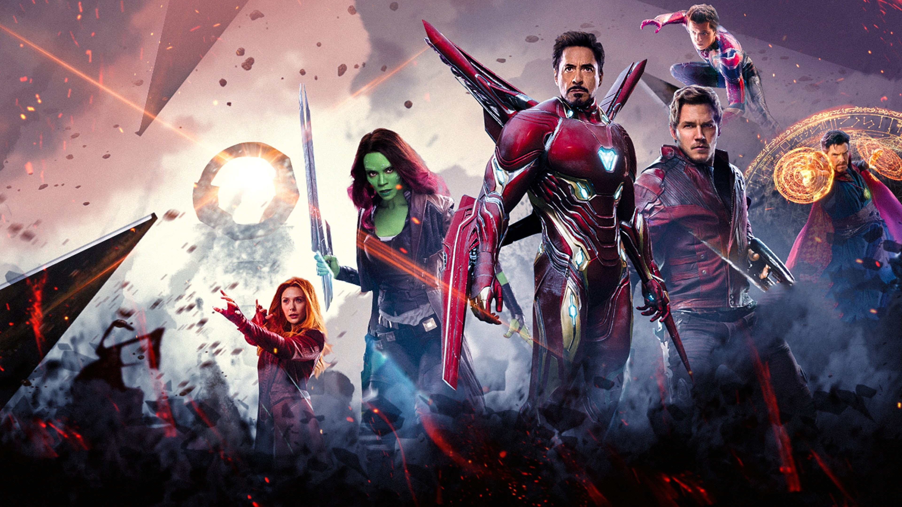
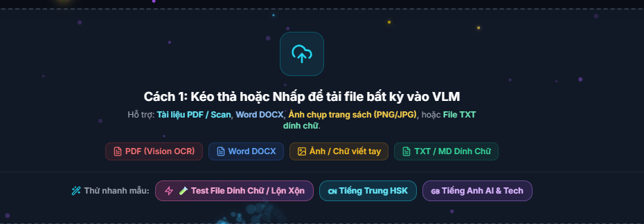
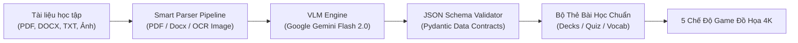
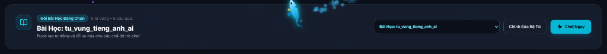
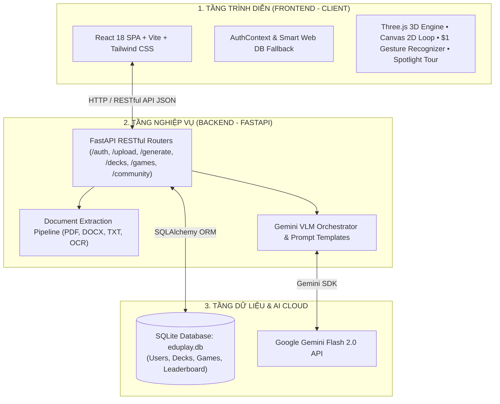
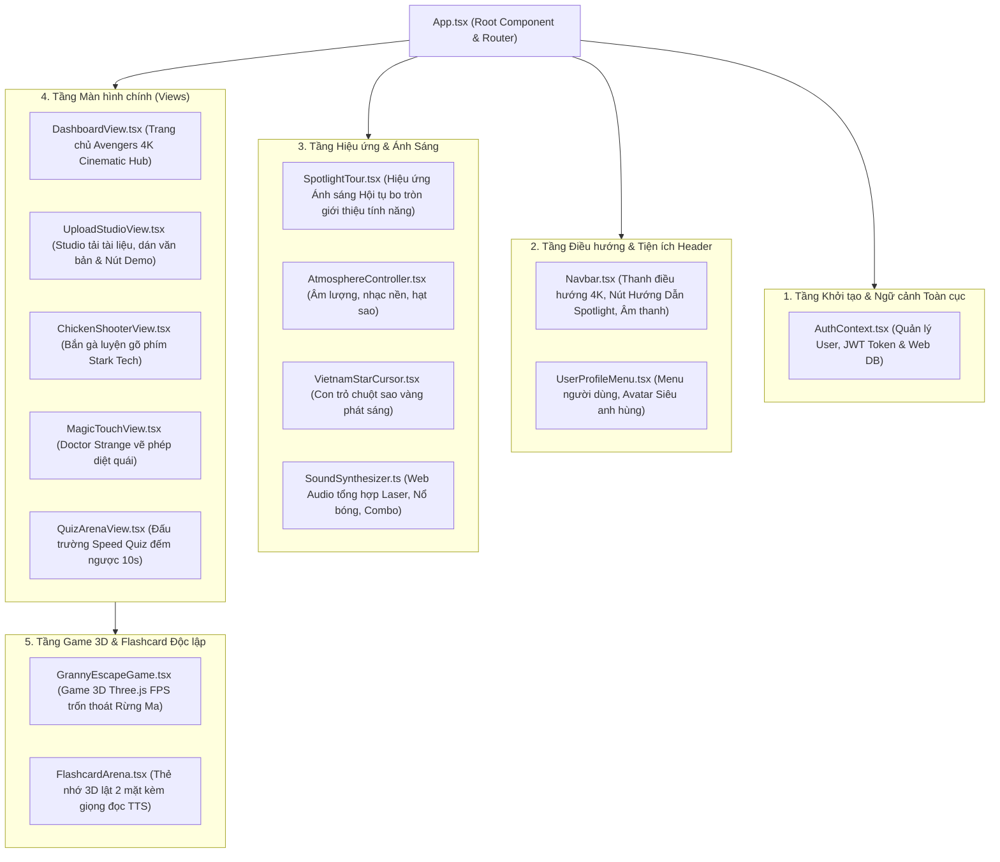

<div align="center">

# 🎮 EDUPLAY AI - NỀN TẢNG HỌC TẬP TRÒ CHƠI HÓA 4K & VLM MULTIMODAL
### *Gamified AI Learning Platform • Powered by Google Gemini & Three.js 3D*

[](https://vercel.com)
[](https://reactjs.org/)
[](https://www.typescriptlang.org/)
[](https://threejs.org/)
[](https://fastapi.tiangolo.com/)
[](https://ai.google.dev/)
[](LICENSE)

<br/>


> **EduPlay** là nền tảng giáo dục tương tác thế hệ mới, ứng dụng **Trí tuệ Nhân tạo Đa phương thức (Multimodal VLM)** và **Đồ họa 3D thời gian thực**. Hệ thống tự động phân tích mọi loại tài liệu học tập thô (sách giáo trình PDF, file Word DOCX, văn bản dính chữ, hình ảnh chụp bài giảng) để biến thành các **đấu trường trò chơi sinh động**, giúp nâng cao 300% khả năng ghi nhớ và tạo cảm hứng học tập bất tận.

[🌐 Trải Nghiệm Web Trực Tiếp](#-triển-khai-lên-web-deployment) • [✨ 5 Chế Độ Game 4K](#-5-chế-độ-trò-chơi-độc-quyền-chuẩn-4k) • [🌟 Hướng Dẫn Spotlight](#-tính-năng-hướng-dẫn-ánh-sáng-hội-tụ-spotlight-tour) • [🏗️ Kiến Trúc Hệ Thống](#-kiến-trúc-và-thiết-kế-hệ-thống) • [🚀 Cài Đặt & Khởi Chạy](#-cài-đặt--khởi-chạy-nhanh) • [📚 Tài Liệu API](#-tài-liệu-api-endpoints)

---

</div>

## 📑 MỤC LỤC
1. [Giới thiệu Dự án](#-giới-thiệu-dự-án)
2. [Tính Năng Hướng Dẫn Ánh Sáng Hội Tụ (Spotlight Tour)](#-tính-năng-hướng-dẫn-ánh-sáng-hội-tụ-spotlight-tour)
3. [5 Chế độ Trò chơi Độc quyền Chuẩn 4K](#-5-chế-độ-trò-chơi-độc-quyền-chuẩn-4k)
4. [Lõi Xử lý AI Đa Phương Thức (VLM Engine & Demo 1-Chạm)](#-lõi-xử-lý-ai-đa-phương-thức-vlm-engine)
5. [Hệ Thống Quản Lý Giáo Trình & 20 Bộ Bài Học Có Sẵn](#-hệ-thống-quản-lý-giáo-trình--20-bộ-bài-học-mẫu)
6. [Kiến Trúc và Thiết Kế Hệ Thống (System Architecture)](#-kiến-trúc-và-thiết-kế-hệ-thống)
   - 6.1. [Mô hình Kiến trúc Phân tầng: 3-Tier Decoupled Architecture](#61-mô-hình-kiến-trúc-tổng-thể-3-tier-decoupled-architecture)
   - 6.2. [Đặc tả Toàn diện Tầng Giao diện (Frontend Component Architecture)](#62-đặc-tả-toàn-diện-tầng-giao-diện-frontend-component-architecture)
   - 6.3. [Đặc tả Tầng Dịch vụ Xử lý Nghiệp vụ Backend (Backend Service Architecture)](#63-đặc-tả-tầng-dịch-vụ-xử-lý-nghiệp-vụ-backend-backend-service-architecture)
   - 6.4. [Bảng Ma trận Đối chiếu Kỹ thuật: Layered vs Microservices](#64-bảng-ma-trận-đối-chiếu-kỹ-thuật-layered-components-vs-distributed-microservices)
7. [Công Nghệ Sử Dụng (Tech Stack)](#-công-nghệ-sử-dụng-tech-stack)
8. [Cấu Trúc Thư Mục Chuẩn Hóa](#-cấu-trúc-thư-mục-chuẩn-hóa)
9. [Cài Đặt & Khởi Chạy Nhanh](#-cài-đặt--khởi-chạy-nhanh)
10. [Triển Khai Lên Web (Deployment)](#-triển-khai-lên-web-deployment)
11. [Tài Liệu API Endpoints](#-tài-liệu-api-endpoints)
12. [Bản Quyền & Tác Giả](#-bản-quyền--tác-giả)

---

## 🌟 GIỚI THIỆU DỰ ÁN

Hầu hết các nền tảng học tập trực tuyến hiện nay chỉ dừng lại ở các bài trắc nghiệm nhàm chán hoặc flashcard thụ động. **EduPlay** giải quyết triệt để vấn đề này bằng việc kết hợp giữa:
- **Gamification (Trò chơi hóa)**: Đưa kiến thức vào các thử thách phản xạ bàn phím, vẽ nét phép thuật cử chỉ, đấu trường trí tuệ và game sinh tồn 3D trốn thoát.
- **Multimodal AI Pipeline**: Đọc hiểu cấu trúc văn bản học thuật, tự động phát hiện từ vựng trọng tâm, sinh câu hỏi trắc nghiệm kèm giải thích logic bằng mô hình ngôn ngữ lớn **Google Gemini Flash 2.0**.
- **Cinematic Experience**: Giao diện chuẩn **4K Ultra-HD phong cách Siêu Anh Hùng Avengers**, hiệu ứng âm thanh số sống động (Web Audio API), trợ lý ảo AI Copilot đồng hành 24/7.

---

## 💡 TÍNH NĂNG HƯỚNG DẪN ÁNH SÁNG HỘI TỤ (SPOTLIGHT TOUR)

Hệ thống tích hợp **Onboarding Tour chuẩn Game AAA** với công nghệ ánh sáng hội tụ (Spotlight Mask):

```
+--------------------------------------------------------------+
| [MÀN HÌNH TỐI MỜ (CINEMATIC BACKDROP)]                      |
|                                                              |
|            /==============================\                  |
|            |  VÙNG ÁNH SÁNG BO TRÒN SÁNG  |  <--- HỘI TỤ VÀO |
|            |   (PULSING GLOW RING + HUD)  |       TÍNH NĂNG  |
|            \==============================/                  |
|                           |                                  |
|               +-----------v---------------------+            |
|               | 💬 TOOLTIP DIALOG: BƯỚC 1/6     |            |
|               |  Giải thích chức năng chi tiết   |            |
|               |  [← Quay lại]  [Tiếp theo →]   |            |
|               +---------------------------------+            |
+--------------------------------------------------------------+
```

- **Màn hình tối mờ & Khối cắt bo tròn (SVG Mask)**: Làm tối toàn bộ màn hình xung quanh và mở một vòng ánh sáng tròn bo mềm mại chính xác tại thành phần đang được giới thiệu.
- **Vòng hào quang & Radar Ping 4K**: Viền ánh sáng Neon Cyan / Vàng phát quang với 4 góc định vị Sci-Fi HUD chuẩn game hành động.
- **Tự động cuộn & Chuyển Tab thông minh**: Hệ thống tự động cuộn màn hình đến vị trí tính năng và đổi Tab nếu cần thiết.
- **Bật/Tắt chủ động**: Người dùng có thể nhấn nút **"Hướng Dẫn"** (biểu tượng La bàn 🧭) trên thanh điều hướng Navbar bất kỳ lúc nào để xem lại hướng dẫn!

---

## 🎮 5 CHẾ ĐỘ TRÒ CHƠI ĐỘC QUYỀN CHUẨN 4K

Mỗi trò chơi được thiết kế theo một phong cách siêu anh hùng Marvel đặc trưng:

| Poster 4K | Tựa Game & Engine | Cơ Chế Tương Tác Kỹ Năng |
| :---: | :--- | :--- |
|  | **1. Stark Reapers (Bắn Gà Luyện Gõ)**<br/>*Custom 2D GameLoop 60 FPS* | Chiến đấu cơ Stark Nano-Armor đánh chặn đàn Drone mang từ vựng. Gõ đúng phím ký tự / Pinyin để khai hỏa tia Plasma hủy diệt! |
|  | **2. Mystic Sanctum (Vẽ Phép Thuật)**<br/>*Canvas 2D + $1 Unistroke Recognizer* | Vẽ cử chỉ tự do (`—`, `\|`, `/`, `\`, `V`, `^`, `O`, `⚡`) với hiệu ứng tia lửa Eldritch để phá nổ bóng bay ma thuật mang chữ Hán! |
|  | **3. Speed Quiz Arena (Đấu Trường Phản Xạ)**<br/>*Stark Tech UI + Web Audio FX* | Đấu trường trắc nghiệm đếm ngược 10 giây tốc độ cao. Đánh giá độ thông hiểu nghĩa từ vựng và tích lũy chuỗi Combo x2, x3, x4! |
|  | **4. Trốn Thoát Rừng Ma Granny 3D**<br/>*Three.js FPS 3-Tier Mansion Engine* | Không gian dinh thự ma ám 3 tầng. Bật đèn pin, né tránh Granny, lén lút trốn vào tủ quần áo và nhặt mảnh cổ tự chữ Hán để mở cổng! |
|  | **5. Flashcard 3D Đa Chiều (Quantum Realm)**<br/>*Three.js 3D Card + Speech TTS* | Thẻ học 3D không gian lật 360°, phát âm audio chuẩn bản xứ, bóc tách cấu tạo chữ viết và tích hợp thuật toán Spaced Repetition! |

---

## 🧠 LÕI XỬ LÝ AI ĐA PHƯƠNG THỨC (VLM ENGINE)





- **Đa định dạng đầu vào**: Hỗ trợ bóc tách nội dung từ tài liệu PDF sách giáo khoa, file Word giáo án (`.docx`), file văn bản (`.txt`) và hình ảnh chụp bảng/sách thông qua thị giác máy tính OCR.
- **Nút Demo Tạo Mẫu Nhanh 1-Chạm**: Người dùng không cần có sẵn tài liệu vẫn có thể thử nghiệm tức thì thông qua 3 nút tạo mẫu tự động:
  * ⚡🧪 **Test File Dính Chữ / Lộn Xộn**: Thử nghiệm khả năng phân tách câu chữ lỗi font.
  * 🇨🇳 **Tiếng Trung HSK**: Tự động tạo trọn bộ từ vựng chữ Hán, Pinyin và Quiz.
  * 🇬🇧 **Tiếng Anh AI & Tech**: Tự động trích xuất các thuật ngữ công nghệ cao.
- **Cơ chế Fallback thông minh**: Tự động chuyển sang ngân hàng dữ liệu ngoại tuyến chuẩn khi mất kết nối mạng hoặc không có API key.

---

## 📚 HỆ THỐNG QUẢN LÝ GIÁO TRÌNH & 20 BỘ BÀI HỌC MẪU



Hệ thống tích hợp sẵn kho dữ liệu khổng lồ **hơn 400 từ vựng và câu hỏi trắc nghiệm** chia thành 20 giáo trình:
1. **HSK 1 - Tiếng Trung Căn Bản**: Chào hỏi, Số đếm, Gia đình, Ẩm thực, Thời gian, Mua sắm (Bài 1 - 6).
2. **HSK 2 - Tiếng Trung Giao Tiếp**: Đi lại, Sở thích, Thời tiết, Cảm xúc, Bệnh viện, Nhà hàng (Bài 7 - 12).
3. **HSK 3 - Tiếng Trung Nâng Cao**: Công sở, Du lịch, Công nghệ số, Văn hóa (Bài 13 - 16).
4. **Tiếng Anh Chuyên Ngành**: CNTT & Lập trình, AI & Data Science, Đàm phán Doanh nghiệp, Du lịch Quốc tế (Bài 17 - 20).

Người dùng có thể dễ dàng quản lý thông qua hai tính năng:
- **`+ Thêm Bộ Từ`**: Nhập tiêu đề, chọn ngôn ngữ và mô tả để tạo gói học mới hoặc nạp nhanh bộ mẫu giáo trình.
- **`Xóa Bộ Từ`**: Hộp thoại xác nhận an toàn giúp loại bỏ các bộ từ không còn nhu cầu học.

---

## 🏗️ KIẾN TRÚC VÀ THIẾT KẾ HỆ THỐNG

### 6.1. Mô hình Kiến trúc Tổng thể: 3-Tier Decoupled Architecture

Hệ thống **EduPlay** được thiết kế dựa trên nguyên lý **Phân tách Trách nhiệm (Separation of Concerns)** theo mô hình **Kiến trúc Phân tầng 3 Tầng Hiện Đại (Modern 3-Tier Decoupled Layered Architecture)**:

- **Tầng Trình Diễn (Presentation Tier - Client)**: Xây dựng độc lập dưới dạng Single Page Application (SPA) bằng **React 18**, **TypeScript** và **Vite**. Tầng này chịu trách nhiệm hiển thị giao diện, tiếp nhận tương tác người dùng, quản lý hoạt ảnh và render đồ họa thời gian thực (Three.js 3D và Canvas 2D).
- **Tầng Nghiệp Vụ (Application / Logic Tier - Server)**: Được đóng gói dưới dạng RESTful API Server bằng **FastAPI (Python)**, vận hành trên nền tảng máy chủ bất đồng bộ Uvicorn ASGI Server. Tầng này chịu trách nhiệm điều phối toàn bộ nghiệp vụ (Business Logic): xác thực bảo mật JWT, xử lý pipeline trích xuất tài liệu, tích hợp trí tuệ nhân tạo và tính toán kết quả xếp hạng.
- **Tầng Dữ Liệu & Dịch Vụ Đám Mây (Data & Cloud Service Tier)**: Quản lý tính bền vững của dữ liệu thông qua cơ sở dữ liệu quan hệ **SQLite** (sử dụng SQLAlchemy ORM) kết hợp cơ chế Web Database Storage dự phòng trên trình duyệt; đồng thời tích hợp dịch vụ trí tuệ nhân tạo ngoại vi **Google Gemini Flash 2.0 API**.



---

### 6.2. Đặc tả Toàn diện Tầng Giao diện (Frontend Component Architecture)

Toàn bộ giao diện người dùng được module hóa thành các **Components** độc lập, có khả năng tái sử dụng cao, phân bố theo cây phân cấp thành phần:



---

### 6.3. Đặc tả Tầng Dịch vụ Xử lý Nghiệp vụ Backend (Backend Service Architecture)

| Nhóm Dịch Vụ Nghiệp Vụ | File Mã Nguồn | Chức Năng Kỹ Thuật Chi Tiết |
| :--- | :--- | :--- |
| **Dịch vụ Bóc tách Tài liệu (Parser Services)** | `base_parser.py`<br>`pdf_parser.py`<br>`docx_parser.py`<br>`txt_parser.py`<br>`image_parser.py` | - `base_parser.py`: Định nghĩa Interface trừu tượng `BaseParser` chuẩn hóa phương thức bóc tách.<br>- `pdf_parser.py`: Sử dụng thư viện `pypdf` bóc tách cấu trúc phân trang của sách giáo trình PDF.<br>- `docx_parser.py`: Sử dụng `python-docx` đọc hiểu văn bản, danh sách gạch đầu dòng trong tài liệu Word.<br>- `txt_parser.py`: Đọc file văn bản thuần, tự động nhận diện bảng mã UTF-8 tiếng Việt.<br>- `image_parser.py`: Tích hợp Gemini Vision OCR nhận diện chữ in và chữ viết tay từ ảnh chụp bài giảng. |
| **Dịch vụ Trí tuệ Nhân tạo (AI & VLM Services)** | `gemini_client.py`<br>`prompt_templates.py`<br>`content_generator.py`<br>`vlm_engine.py` | - `gemini_client.py`: Quản lý kết nối Google Gemini Flash 2.0 API, thiết lập cấu hình tham số sinh và ép kiểu đầu ra JSON Schema chuẩn.<br>- `prompt_templates.py`: Kho lưu trữ System Prompt kỹ thuật tối ưu hóa cho từng môn học.<br>- `content_generator.py`: Điều phối luồng xử lý AI, phân loại độ khó và kích hoạt **Fallback Heuristic** (dùng dữ liệu mẫu) khi mất kết nối mạng.<br>- `vlm_engine.py`: Lõi xử lý đa phương thức kết hợp văn bản và hình ảnh học tập. |
| **Dịch vụ Xác thực & Bảo mật (Auth & Security Services)** | `core/security.py`<br>`api/v1/auth.py`<br>`core/deps.py` | - `core/security.py`: Mã hóa mật khẩu một chiều bằng thuật toán an toàn `Bcrypt / Passlib`; sinh và kiểm tra chữ ký điện tử **JWT Bearer Token**.<br>- `api/v1/auth.py`: Xử lý endpoint đăng ký tài khoản, đăng nhập, lấy hồ sơ cá nhân (`/auth/me`) và cập nhật Avatar (`/auth/profile`).<br>- `core/deps.py`: Dependency Middleware xác thực token và kiểm tra phân quyền truy cập `user` vs `admin`. |
| **Dịch vụ Quản lý Bài học (Decks & Data Services)** | `api/v1/decks.py`<br>`services/sample_data.py` | - `api/v1/decks.py`: Quản lý các gói học tập `LearningPackage`, lưu trữ và nạp các bộ câu hỏi `QuizDeck` và từ vựng `VocabularyDeck`, hỗ trợ thêm và xóa bộ từ vựng (`DELETE /api/v1/decks/{deck_id}`).<br>- `services/sample_data.py`: Cung cấp kho dữ liệu mẫu chuẩn (Tiếng Trung HSK 1-3, Tiếng Anh CNTT/AI) để hệ thống hoạt động ngay cả khi ngoại tuyến. |
| **Dịch vụ Ghi nhận & Xếp hạng (Game Analytics Services)** | `api/v1/games.py` | - Lưu trữ chi tiết thông số từng ván chơi (`game_sessions`): số điểm, độ chính xác (accuracy), chuỗi combo cao nhất, thời gian chơi.<br>- Tổng hợp và tính toán danh sách Top người chơi đạt điểm cao nhất toàn cầu trên Bảng xếp hạng (`/games/leaderboard`). |
| **Dịch vụ Quản trị CSDL (Web Database Admin Services)** | `api/v1/admin_db.py` | - Trích xuất lược đồ (Schema) CSDL SQLite (`eduplay.db`), liệt kê danh sách các bảng và số lượng dòng dữ liệu.<br>- Hỗ trợ xem dữ liệu có phân trang, tìm kiếm bản ghi theo từ khóa và xóa dữ liệu trực tiếp từ giao diện Admin. |

---

### 6.4. Bảng Ma trận Đối chiếu Kỹ thuật: Layered Components vs Distributed Microservices

| Tiêu Chí So Sánh | Component (trong Kiến trúc Phân tầng Layered - EduPlay) | Service (trong Kiến trúc Microservices Phân tán) |
| :--- | :--- | :--- |
| **Bản chất Kiến trúc** | Đơn vị cấu thành mã nguồn (Module, Class, File) nằm trong một tầng logic của ứng dụng. | Tiến trình phần mềm hoàn chỉnh, độc lập (Autonomous Service Process) phục vụ một nghiệp vụ riêng biệt. |
| **Môi trường Thực thi (Runtime)** | Chạy **trong cùng một tiến trình (In-Process)**. Chia sẻ chung không gian bộ nhớ RAM, CPU của máy chủ ứng dụng. | Chạy trên **các tiến trình riêng biệt (Out-of-Process)**. Thường được đóng gói trong các Container riêng (Docker, Kubernetes). |
| **Giao thức Giao tiếp** | Sử dụng **lời gọi hàm trực tiếp trong RAM (In-Memory Method Call)**. Tốc độ thực thi cực nhanh (nano-giây), không có độ trễ mạng. | Sử dụng **Giao thức Mạng (Network Protocols)** như HTTP/REST, gRPC, WebSocket hoặc Message Broker (Kafka, RabbitMQ). Có độ trễ mạng. |
| **Chiến lược Quản lý Dữ liệu** | **Cơ sở dữ liệu tập trung dùng chung (Shared Database)**. Mọi Component trong tầng Business Logic đều thao tác với cùng một CSDL. | Tuân theo nguyên tắc **Database-per-Service**: Mỗi Service quản lý một CSDL độc lập, nghiêm cấm truy cập trực tiếp chéo CSDL. |
| **Mô hình Triển khai** | **Triển khai đồng loạt (Atomic/Monolithic Deploy)**: Khi cập nhật một Component, toàn bộ ứng dụng Backend được đóng gói và triển khai cùng nhau. | **Triển khai độc lập (Independent Deployability)**: Mỗi Service có pipeline CI/CD riêng, có thể triển khai cập nhật Service A mà không ảnh hưởng tới Service B. |
| **Chiến lược Co giãn (Scaling)** | Mở rộng theo chiều ngang (Scale) bằng cách nhân bản **toàn bộ tiến trình ứng dụng Backend**. | **Co giãn linh hoạt từng phần (Granular Scaling)**: Có thể cấp riêng tài nguyên phần cứng (CPU/GPU) cho Service có tải trọng lớn (ví dụ AI Service). |

---

## 💻 CÔNG NGHỆ SỬ DỤNG (TECH STACK)

| Phân tầng | Công nghệ cốt lõi | Chi tiết tính năng |
| :--- | :--- | :--- |
| **Frontend** | **React 18**, **TypeScript**, **Vite** | Single Page Application tốc độ cao, quản lý State tập trung bằng React Hooks & Context. |
| **Đồ họa & Hiệu ứng** | **Three.js**, **React Three Fiber**, **Tailwind CSS** | Kết xuất 3D không gian, ánh sáng động thời gian thực, hiệu ứng ánh sáng hội tụ Spotlight Mask. |
| **Game Engine** | **HTML5 Canvas 2D**, **Web Audio API** | Vòng lặp trò chơi độc lập FPS, thuật toán nhận dạng nét vẽ `$1 Unistroke`, âm thanh tổng hợp đa âm sắc. |
| **Backend API** | **FastAPI (Python 3.10+)**, **Uvicorn** | Máy chủ bất đồng bộ ASGI (async/await), Pydantic validation, chuẩn RESTful JSON. |
| **Trí tuệ nhân tạo (AI)** | **Google Gemini Flash 2.0 API** | Vision-Language Model thế hệ mới, đọc hiểu văn bản và ảnh chụp bài giảng. |
| **Cơ sở dữ liệu** | **SQLite (SQLAlchemy ORM) & LocalStorage DB** | Lưu trữ người dùng, mật khẩu mã hóa bcrypt, bộ câu hỏi, lịch sử ván chơi và bảng xếp hạng. |
| **Bảo mật** | **JWT (JSON Web Token)**, **Passlib Bcrypt** | Xác thực phân quyền Người dùng (User) và Quản trị viên (Admin). |
| **Triển khai (Deploy)** | **Vercel**, **Git Version Control** | Triển khai web 1-click, tự động build SPA với tệp cấu hình tối ưu. |

---

## 📁 CẤU TRÚC THƯ MỤC CHUẨN HÓA

```
M:\Game/
├── docs/                                # Tài liệu hình ảnh và screenshots dự án
│   └── images/                          # Ảnh minh họa 4K, banner và chụp màn hình
├── frontend/                            # Ứng dụng Client (React 18 + Vite)
│   ├── public/assets/                   # Ảnh nền Avengers 4K, texture 3D, âm thanh
│   ├── src/
│   │   ├── components/                  # Giao diện tái sử dụng
│   │   │   ├── admin/                   # WebDatabaseAdminModal (Quản trị CSDL)
│   │   │   ├── auth/                    # AuthModal, Leaderboard, UserProfileMenu
│   │   │   ├── effects/                 # SpotlightTour (Ánh sáng hội tụ), Cursor, Star
│   │   │   ├── games/                   # GrannyEscapeGame (3D), FlashcardArena
│   │   │   └── upload/                  # DocumentUpload, DeckEditor
│   │   ├── context/                     # AuthContext (Xác thực & phân quyền)
│   │   ├── games/                       # Lõi Game Engines độc lập
│   │   │   ├── chicken-shooter/         # Bắn tàu không gian luyện gõ
│   │   │   ├── magic-touch/             # Vẽ phép diệt quái (Gesture Recognizer)
│   │   │   └── common/                  # GameLoop, ParticleEngine, SoundSynthesizer
│   │   ├── lib/                         # api.ts, curriculumData.ts (20 bộ giáo trình)
│   │   └── views/                       # Dashboard, UploadStudio, Game Arenas
│   ├── package.json                     # Quản lý dependencies frontend
│   └── vercel.json                      # Cấu hình rewrite URL cho Vercel SPA
│
├── backend/                             # Máy chủ API (Python FastAPI)
│   ├── app/
│   │   ├── api/v1/                      # Endpoints: auth, upload, generate, decks, games, admin
│   │   ├── core/                        # Cấu hình bảo mật JWT, dependencies
│   │   ├── db/                          # Models SQLAlchemy, khởi tạo CSDL
│   │   ├── models/                      # Pydantic Schemas
│   │   └── services/                    # Parsers tài liệu (PDF, Word, OCR) & AI Generator
│   ├── eduplay.db                       # Cơ sở dữ liệu SQLite
│   └── requirements.txt                 # Thư viện Python Backend
│
├── sample_files/                        # Tài liệu bài học mẫu để test hệ thống
├── start_all.bat                        # Script khởi chạy 1-Click toàn bộ Frontend & Backend
├── package.json                         # Root build script hỗ trợ Vercel
├── vercel.json                          # Root Vercel routing configuration
└── README.md                            # Tài liệu dự án duy nhất chuẩn hóa
```

---

## 🚀 CÀI ĐẶT & KHỞI CHẠY NHANH

### Yêu cầu môi trường:
- **Node.js**: Phiên bản 18.x trở lên.
- **Python**: Phiên bản 3.10 trở lên.
- **Trình duyệt**: Google Chrome, Microsoft Edge, Firefox (hỗ trợ WebGL để trải nghiệm 3D mượt mà).

---

### Cách 1: Khởi động tự động 1-Click (Dành cho Windows)
Chỉ cần nhấp đúp chuột vào file:
```cmd
start_all.bat
```
Hệ thống sẽ tự động bật 2 cửa sổ song song:
1. **Backend FastAPI**: Đang chạy tại `http://localhost:8000` (kèm tài liệu tương tác tại `http://localhost:8000/docs`).
2. **Frontend React**: Đang chạy tại `http://localhost:5173`.
Trình duyệt sẽ tự động mở trang web EduPlay sẵn sàng để bạn trải nghiệm!

---

### Cách 2: Khởi động thủ công bằng dòng lệnh

#### 1. Khởi chạy Backend:
```bash
cd backend
python -m venv venv
venv\Scripts\activate       # Trên Windows (hoặc: source venv/bin/activate trên Mac/Linux)
pip install -r requirements.txt
python -m uvicorn app.main:app --host 127.0.0.1 --port 8000 --reload
```

#### 2. Khởi chạy Frontend:
Mở một cửa sổ dòng lệnh mới:
```bash
cd frontend
npm install
npm run dev
```
Truy cập đường dẫn: **`http://localhost:5173`**

---

## 🌐 TRIỂN KHAI LÊN WEB (DEPLOYMENT)

Hệ thống đã được thiết lập sẵn sàng để triển khai lên nền tảng đám mây **Vercel** chỉ trong 3 bước:

1. Đăng nhập vào [Vercel](https://vercel.com) bằng tài khoản GitHub của bạn.
2. Bấm **"Add New..."** ➔ Chọn **"Project"** ➔ Chọn repository **`Game`**.
3. Cấu hình cài đặt:
   - **Framework Preset**: Chọn **Vite**.
   - **Root Directory**: Giữ nguyên `./` (đã có cấu hình root `vercel.json` tự động).
   - Bấm **"Deploy"**.
4. Sau 1 phút, bạn sẽ nhận được đường link web trực tuyến có định dạng:
   👉 `https://game-eduplay.vercel.app` (Mở được trên cả máy tính lẫn điện thoại di động).

> 💡 **Lưu ý**: Nhờ cơ chế **Web Database Fallback**, khi chạy trên Vercel dù không có server Python Backend, người dùng vẫn có thể **Đăng ký tài khoản mới**, **Đăng nhập mẫu với Tony Stark**, **Chơi toàn bộ 5 mini-game** và **Lưu điểm số** hoàn toàn trơn tru!

---

## 📚 TÀI LIỆU API ENDPOINTS

Hệ thống cung cấp hệ thống API RESTful toàn diện, có thể kiểm thử trực tiếp qua Swagger UI tại `http://localhost:8000/docs`:

### Nhóm Xác Thực & Người Dùng (`/api/v1/auth`)
- `POST /api/v1/auth/register`: Đăng ký tài khoản người chơi mới.
- `POST /api/v1/auth/login`: Đăng nhập bằng Username/Email và nhận JWT Bearer Token.
- `GET /api/v1/auth/me`: Lấy thông tin hồ sơ tài khoản hiện tại.
- `PUT /api/v1/auth/profile`: Cập nhật tên hiển thị hoặc Avatar Siêu Anh Hùng.

### Nhóm Tải Lên & Tạo Sinh AI (`/api/v1/`)
- `POST /api/v1/upload`: Tải lên tài liệu PDF, DOCX, TXT hoặc ảnh chụp bài giảng để trích xuất nội dung thô.
- `POST /api/v1/generate`: Gửi văn bản bài học đến Gemini Flash 2.0 để sinh bộ câu hỏi và từ vựng tự động.
- `GET /api/v1/decks`: Lấy danh sách toàn bộ các bộ bài học trong hệ thống.
- `POST /api/v1/decks`: Lưu một bộ bài học tùy chỉnh mới vào CSDL.
- `DELETE /api/v1/decks/{deck_id}`: Xóa một bộ bài học tùy chỉnh khỏi hệ thống.

### Nhóm Trò Chơi & Xếp Hạng (`/api/v1/games`)
- `POST /api/v1/games/record`: Lưu trữ kết quả ván chơi, độ chính xác và chuỗi combo.
- `GET /api/v1/games/leaderboard`: Lấy danh sách Top chiến binh đạt điểm cao nhất toàn cầu.

### Nhóm Quản Trị CSDL (`/api/v1/admin/db`)
- `GET /api/v1/admin/db/tables`: Xem tổng quan cấu trúc và số lượng bản ghi các bảng trong CSDL.
- `GET /api/v1/admin/db/table/{table_name}`: Xem chi tiết dữ liệu bảng kèm tính năng phân trang và tìm kiếm.

---

## 👨‍💻 BẢN QUYỀN & TÁC GIẢ

- **Đơn vị phát triển**: Dự án Nghiên Cứu & Phát Triển Ứng Dụng Giáo Dục Thông Minh (EduPlay Team).
- **Tác giả / Lead Developer**: [bangmanhbac-max](https://github.com/bangmanhbac-max)
- **Giấy phép bản quyền**: Phát hành theo giấy phép mã nguồn mở [MIT License](LICENSE).

<div align="center">
  <sub>Xây dựng với tất cả niềm đam mê công nghệ giáo dục và trí tuệ nhân tạo ❤️ 2026</sub>
</div>
