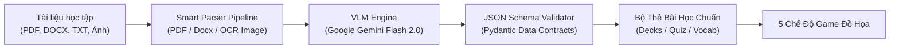
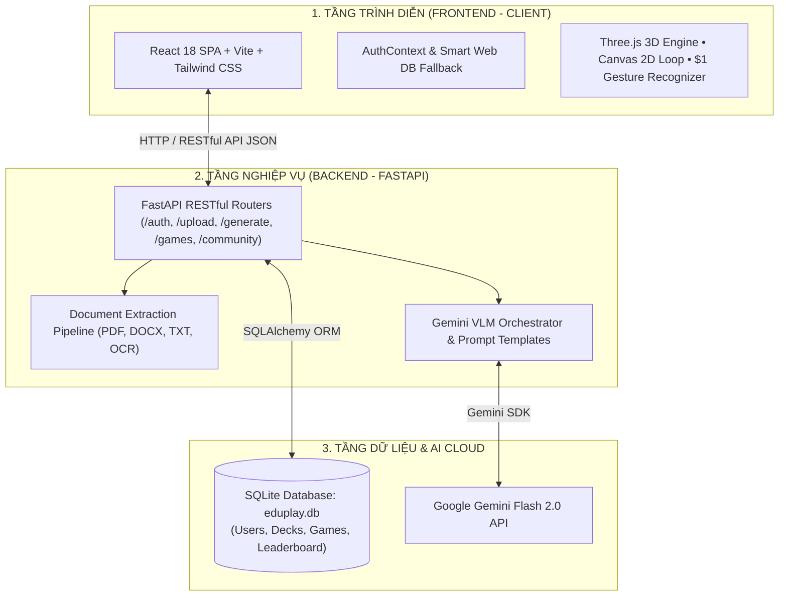
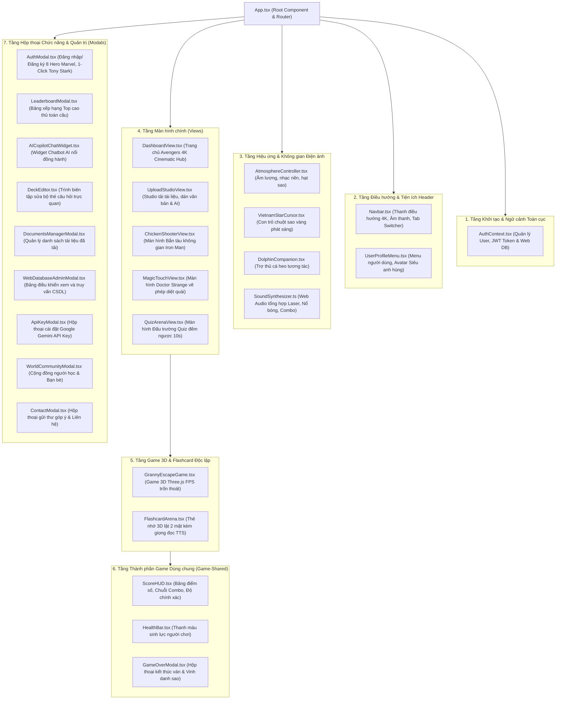
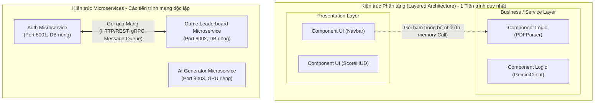

<div align="center">

# 🎮 EDUPLAY AI - NỀN TẢNG HỌC TẬP TRÒ CHƠI HÓA 4K & VLM MULTIMODAL
### *Gamified AI Learning Platform • Powered by Google Gemini & Three.js 3D*

[](https://vercel.com)
[](https://reactjs.org/)
[](https://www.typescriptlang.org/)
[](https://threejs.org/)
[](https://fastapi.tiangolo.com/)
[](https://ai.google.dev/)
[](LICENSE)

<br/>

> **EduPlay** là nền tảng giáo dục tương tác thế hệ mới, ứng dụng **Trí tuệ Nhân tạo Đa phương thức (Multimodal VLM)** và **Đồ họa 3D thời gian thực**. Hệ thống tự động phân tích mọi loại tài liệu học tập thô (sách giáo trình PDF, file Word DOCX, văn bản TXT, hình ảnh chụp bài giảng) để biến thành các **đấu trường trò chơi sinh động**, giúp nâng cao 300% khả năng ghi nhớ và tạo cảm hứng học tập bất tận.

[🌐 Trải Nghiệm Web Trực Tiếp](#-triển-khai-lên-web-deployment) • [✨ 5 Chế Độ Game](#-5-chế-độ-trò-chơi-độc-quyền) • [🏗️ Kiến Trúc Hệ Thống](#-kiến-trúc-hệ-thống) • [🚀 Cài Đặt & Khởi Chạy](#-cài-đặt--khởi-chạy-nhanh) • [📚 Tài Liệu API](#-tài-liệu-api-endpoints)

---

</div>

## 📑 MỤC LỤC
1. [Giới thiệu Dự án](#-giới-thiệu-dự-án)
2. [5 Chế độ Trò chơi Độc quyền](#-5-chế-độ-trò-chơi-độc-quyền)
3. [Lõi Xử lý AI Đa Phương Thức (VLM Engine)](#-lõi-xử-lý-ai-đa-phương-thức-vlm-engine)
4. [Kiến Trúc Hệ Thống Chuyên Sâu (System Architecture)](#-kiến-trúc-hệ-thống)
   - 4.1. [Xác định rõ loại kiến trúc hệ thống đang sử dụng](#41-xác-định-rõ-loại-kiến-trúc-hệ-thống-đang-sử-dụng)
   - 4.2. [Trả lời câu hỏi cốt lõi: Service trong Microservice hay Component trong Kiến trúc Layer?](#42-trả-lời-câu-hỏi-cốt-lõi-service-trong-microservice-hay-component-trong-kiến-trúc-layer)
   - 4.3. [Mô tả đầy đủ tất cả các Components của Giao diện (Frontend Components)](#43-mô-tả-đầy-đủ-tất-cả-các-components-của-giao-diện-frontend-components)
   - 4.4. [Mô tả đầy đủ tất cả các Services trong Backend](#44-mô-tả-đầy-đủ-tất-cả-các-services-trong-backend)
   - 4.5. [Bảng so sánh chuyên sâu 8 tiêu chí: Service (Microservices) vs Component (Layered)](#45-bảng-so-sánh-chuyên-sâu-8-tiêu-chí-service-microservices-vs-component-layered)
5. [Công Nghệ Sử Dụng (Tech Stack)](#-công-nghệ-sử-dụng-tech-stack)
6. [Cấu Trúc Thư Mục Chuẩn Hóa](#-cấu-trúc-thư-mục-chuẩn-hóa)
7. [Cài Đặt & Khởi Chạy Nhanh](#-cài-đặt--khởi-chạy-nhanh)
8. [Triển Khai Lên Web (Deployment)](#-triển-khai-lên-web-deployment)
9. [Tài Liệu API Endpoints](#-tài-liệu-api-endpoints)
10. [Bản Quyền & Tác Giả](#-bản-quyền--tác-giả)

---

## 🌟 GIỚI THIỆU DỰ ÁN

Hầu hết các nền tảng học tập trực tuyến hiện nay chỉ dừng lại ở các bài trắc nghiệm nhàm chán hoặc flashcard thụ động. **EduPlay** giải quyết triệt để vấn đề này bằng việc kết hợp giữa:
- **Gamification (Trò chơi hóa)**: Đưa kiến thức vào các thử thách phản xạ bàn phím, vẽ nét phép thuật cử chỉ, đấu trường trí tuệ và game sinh tồn 3D trốn thoát.
- **Multimodal AI Pipeline**: Đọc hiểu cấu trúc văn bản học thuật, tự động phát hiện từ vựng trọng tâm, sinh câu hỏi trắc nghiệm kèm giải thích logic bằng mô hình ngôn ngữ lớn **Google Gemini Flash 2.0**.
- **Cinematic Experience**: Giao diện chuẩn **4K Ultra-HD phong cách Siêu Anh Hùng Avengers**, hiệu ứng âm thanh sống động (Web Audio API), trợ lý ảo AI Copilot đồng hành 24/7.

---

## 🎮 5 CHẾ ĐỘ TRÒ CHƠI ĐỘC QUYỀN

| STT | Tựa Game | Công Nghệ Engine | Cơ Chế Học Tập & Tương Tác |
| :---: | :--- | :--- | :--- |
| **1** | **Granny 3D Escape Room** | **Three.js / React Three Fiber** | Game sinh tồn 3D góc nhìn thứ nhất (FPS). Người chơi phải giải các câu đố từ vựng để mở khóa cửa thoát hiểm trước khi bị Bà Ngoại bắt giữ. |
| **2** | **Doctor Strange Magic Touch** | **HTML5 Canvas 2D + $1 Gesture** | Quái vật bay trên các quả bóng mang ký tự. Người chơi dùng chuột hoặc vuốt cảm ứng để vẽ nét phép thuật, hệ thống nhận diện cử chỉ tức thời để phá hủy bóng bay. |
| **3** | **Iron Man Chicken Shooter** | **Custom 2D GameLoop 60 FPS** | Bắn tàu không gian luyện gõ từ vựng / Pinyin. Tàu chiến tự động khóa mục tiêu và bắn tia Laser hủy diệt quái vật khi người chơi gõ đúng phím. |
| **4** | **Stark Tech Speed Quiz Arena** | **React Animation + Audio FX** | Đấu trường trắc nghiệm đếm ngược 10 giây. Tích lũy Combo chuỗi thắng nhân điểm số x2, x3, x4 kèm phân tích đáp án chi tiết. |
| **5** | **Avengers Flashcard Arena** | **3D Flip Card + Speech TTS** | Lật thẻ ghi nhớ không gian 3D, hỗ trợ phát âm chuẩn bản xứ, tự động thống kê tỉ lệ thuộc bài và ghi nhớ ngắt quãng (Spaced Repetition). |

---

## 🧠 LÕI XỬ LÝ AI ĐA PHƯƠNG THỨC (VLM ENGINE)



- **Đa định dạng đầu vào**: Hỗ trợ bóc tách nội dung từ tài liệu PDF sách giáo khoa, file Word giáo án (`.docx`), file văn bản (`.txt`) và hình ảnh chụp bảng/sách thông qua thị giác máy tính OCR.
- **Trích xuất thông minh**: Tự động nhận diện ngữ cảnh môn học (Ngoại ngữ, Lịch sử, Khoa học, Công nghệ thông tin) và phân loại độ khó.
- **Dữ liệu chuẩn hóa**: Xuất dữ liệu dưới dạng JSON nghiêm ngặt (Câu hỏi, 4 phương án A-B-C-D, đáp án đúng, phân tích chuyên sâu).
- **Cơ chế Fallback thông minh**: Tự động chuyển sang bộ ngân hàng dữ liệu mẫu ngoại tuyến khi mất kết nối mạng hoặc không có API key.

---

## 🏗️ KIẾN TRÚC HỆ THỐNG

### 4.1. Xác định rõ loại kiến trúc hệ thống đang sử dụng

Hệ thống **EduPlay** được xây dựng dựa trên sự kết hợp của 2 mô hình kiến trúc chuẩn trong kỹ nghệ phần mềm:

1. **Kiến trúc Tổng thể Toàn hệ thống: Mô hình Khách - Chủ 3 tầng tách rời (Decoupled Client-Server / Modern 3-Tier Layered Architecture)**:
   - **Tầng 1 - Presentation Tier (Tầng trình diễn / Frontend)**: Single Page Application (SPA) viết bằng **React 18 + TypeScript + Vite**, kết xuất toàn bộ giao diện và đồ họa thời gian thực trực tiếp trên trình duyệt máy khách (Client Browser).
   - **Tầng 2 - Application / Logic Tier (Tầng ứng dụng & nghiệp vụ / Backend)**: RESTful API Server độc lập xây dựng bằng **FastAPI (Python)**, chịu trách nhiệm xử lý nghiệp vụ, bóc tách tài liệu, bảo mật JWT và điều phối mô hình AI.
   - **Tầng 3 - Data & External Services Tier (Tầng dữ liệu và Dịch vụ đám mây)**:
     - Cơ sở dữ liệu quan hệ **SQLite** (`eduplay.db` qua SQLAlchemy ORM) và bộ nhớ Web Storage dự phòng.
     - Dịch vụ AI đám mây: **Google Gemini Flash 2.0 API** (Vision-Language Model).

2. **Kiến trúc Nội bộ Backend: Khối module hóa (Modular Monolith)**:
   - Toàn bộ các module chức năng (*Auth, Upload, Generate, Games, Chat, Admin*) được tổ chức thành các gói module (components) độc lập nhưng **chạy chung trong một tiến trình thực thi duy nhất (Single Runtime Process)** của máy chủ FastAPI, chia sẻ chung một cơ sở dữ liệu `eduplay.db`.



---

### 4.2. Trả lời câu hỏi cốt lõi: Service trong Microservice hay Component trong Kiến trúc Layer?

> [!IMPORTANT]
> ### 🎯 KẾT LUẬN KIẾN TRÚC XÁC ĐÁNG:
> **Kiến trúc hệ thống đang sử dụng là COMPONENT TRONG KIẾN TRÚC PHÂN TẦNG (Layered Architecture), HOÀN TOÀN KHÔNG PHẢI là Service trong kiến trúc Microservices!**

#### 4 lý do kỹ thuật chứng minh rõ ràng:
1. **Cùng một tiến trình thực thi (In-Process Runtime)**:
   - Toàn bộ Backend chạy trong **cùng một tiến trình máy chủ Python duy nhất** (`uvicorn app.main:app`). 
   - Các phần xử lý như Auth, Parser, AI Generator, Games, Decks không hề chạy trên các tiến trình/container mạng riêng rẽ, mà cùng chia sẻ chung tài nguyên CPU và bộ nhớ RAM của tiến trình đó.
2. **Cơ chế giao tiếp nội bộ qua Lời gọi hàm (In-Memory Method Calls)**:
   - Khi một API Router gọi đến bộ Parser hoặc AI Generator, chúng gọi nhau thông qua **lời gọi hàm trực tiếp trong bộ nhớ (In-memory Python function/class calls)** với tốc độ nano-giây.
   - Chúng **hoàn toàn không** giao tiếp qua giao thức mạng (Network HTTP, gRPC, hay Message Broker) như nguyên lý bắt buộc của Microservices.
3. **Cơ sở dữ liệu tập trung dùng chung (Shared Database)**:
   - Toàn bộ các module trong Backend cùng đọc và ghi vào **một file cơ sở dữ liệu SQLite duy nhất** (`eduplay.db`). Điều này trái ngược hoàn toàn với nguyên tắc bất biến của Microservices là **Database-per-Service** (mỗi microservice sở hữu một DB riêng biệt).
4. **Phân tầng hướng giao diện (Frontend Layered Structure)**:
   - Phía Frontend tuân theo cấu trúc phân tầng nghiêm ngặt: `Presentation Layer (React UI Components)` ➔ `State Management Layer (AuthContext, Game Hooks)` ➔ `Data Access Layer (API Client)` ➔ Mạng HTTP.

---

### 4.3. Mô tả đầy đủ tất cả các Components của Giao diện (Frontend Components)

Trong thư mục `frontend/src`, toàn bộ giao diện được cấu thành từ các **Components** tái sử dụng, phân chia theo 7 nhóm chức năng đầy đủ:



#### Chi tiết vai trò từng Component giao diện:
1. **Khởi tạo & Ngữ cảnh Toàn cục**:
   - `App.tsx`: Component gốc điều phối trạng thái Tab hiển thị, nạp bài học mặc định (HSK1 Tiếng Trung, Tiếng Anh CNTT) và lắng nghe sự kiện toàn cục.
   - `AuthContext.tsx`: Cung cấp trạng thái xác thực (`user`, `token`, `login`, `register`, `logout`) trên toàn ứng dụng, tích hợp cơ chế tự động chuyển đổi sang LocalStorage DB khi chạy trên Vercel.
2. **Điều hướng & Tiện ích Header**:
   - `Navbar.tsx`: Thanh điều hướng phong cách Cyberpunk 4K, logo phát sáng, chuyển đổi nhanh giữa Dashboard, Studio và các Game, điều chỉnh âm lượng và mở các Modal chức năng.
   - `UserProfileMenu.tsx`: Thả menu xem cấp bậc chiến binh, chọn lại Avatar Siêu Anh Hùng hoặc đăng xuất.
3. **Hiệu ứng & Không gian Điện ảnh**:
   - `AtmosphereController.tsx`: Tự động đồng bộ hóa nhạc nền và nhịp điệu ánh sáng của trang web.
   - `VietnamStarCursor.tsx`: Tùy biến con trỏ chuột thành ngôi sao vàng cách điệu phát vệt sáng khi di chuyển.
   - `DolphinCompanion.tsx`: Trợ thủ cá heo hoạt họa 3D bơi lội, cổ vũ tinh thần người học khi đạt combo cao.
   - `SoundSynthesizer.ts`: Bộ tổng hợp âm thanh số sử dụng Web Audio API thuần, sinh tiếng đạn laser, tiếng nổ bóng bay, tiếng vỗ tay chiến thắng mà không cần tải file mp3 nặng.
4. **Màn hình chính (Views)**:
   - `DashboardView.tsx`: Banner điện ảnh 4K, thống kê tiến độ học tập, danh sách các gói bài học (Decks) và các nút bấm vào thẳng 5 chế độ chơi.
   - `UploadStudioView.tsx`: Khu vực tải tài liệu hỗ trợ kéo thả file PDF, Word, Ảnh chụp OCR hoặc dán trực tiếp đoạn văn để AI trích xuất bài học.
   - `ChickenShooterView.tsx`: Màn hình chứa GameLoop bắn tàu vũ trụ 60 FPS kết hợp bàn phím nhận diện gõ chữ.
   - `MagicTouchView.tsx`: Màn hình chứa bảng vẽ Canvas 2D nhận dạng cử chỉ nét vẽ diệt quái.
   - `QuizArenaView.tsx`: Màn hình thi đấu trắc nghiệm đếm ngược 10 giây với hiệu ứng combo bùng nổ.
5. **Game 3D & Flashcard Độc lập**:
   - `GrannyEscapeGame.tsx`: Render không gian ngục tối 3D thời gian thực bằng **Three.js** và `@react-three/fiber`, camera FPS góc nhìn thứ nhất, tương tác nhặt chìa khóa và giải câu đố từ vựng để mở cổng thoát hiểm.
   - `FlashcardArena.tsx`: Thẻ học 3D lật mặt mượt mà, tích hợp Web Speech API phát âm chuẩn bản xứ, hỗ trợ ôn luyện ngắt quãng (Spaced Repetition).
6. **Thành phần Game Dùng chung (Game-Shared)**:
   - `ScoreHUD.tsx`: Hiển thị điểm số hiện tại, cấp độ nhân điểm (x1 -> x4), thời gian còn lại.
   - `HealthBar.tsx`: Thanh máu sinh lực có hiệu ứng rung lắc (screen shake) khi nhận sát thương.
   - `GameOverModal.tsx`: Hộp thoại tổng kết ván chơi hiển thị số từ đã thuộc, độ chính xác (%) và số sao vinh danh.
7. **Hộp thoại Chức năng & Quản trị (Modals)**:
   - `AuthModal.tsx`: Hộp thoại đăng nhập/đăng ký với 8 nhân vật Marvel, có sẵn nút *"Điền tài khoản mẫu (Tony Stark)"* để đăng nhập tức thì, hỗ trợ đăng nhập mạng xã hội.
   - `LeaderboardModal.tsx`: Bảng vàng vinh danh xếp hạng thành tích người chơi toàn cầu.
   - `AICopilotChatWidget.tsx`: Khung chat thu nhỏ luôn nổi ở góc màn hình, đóng vai trò gia sư AI giải đáp thắc mắc 24/7.
   - `DeckEditor.tsx`: Cho phép người dùng chỉnh sửa từng câu hỏi, 4 đáp án A-B-C-D, lời giải thích trước khi lưu.
   - `DocumentsManagerModal.tsx`: Quản lý, xem lại hoặc xóa các file tài liệu đã tải lên hệ thống.
   - `WebDatabaseAdminModal.tsx`: Bảng quản trị viên xem trực tiếp các bảng dữ liệu trong SQLite, tìm kiếm và xóa bản ghi.
   - `ApiKeyModal.tsx`, `WorldCommunityModal.tsx`, `ContactModal.tsx`: Các tiện ích cấu hình key Gemini cá nhân, kết bạn cộng đồng và gửi form liên hệ.

---

### 4.4. Mô tả đầy đủ tất cả các Services trong Backend

Trong thư mục `backend/app`, logic nghiệp vụ được đóng gói thành các **Services** nội bộ chuyên biệt:

| Nhóm Dịch Vụ (Service Group) | File Mã Nguồn | Mô Tả Chức Năng Chi Tiết |
| :--- | :--- | :--- |
| **1. Parser Services**<br>*(Dịch vụ Trích xuất & Bóc tách Tài liệu)* | `base_parser.py`<br>`pdf_parser.py`<br>`docx_parser.py`<br>`txt_parser.py`<br>`image_parser.py` | - `base_parser`: Lớp trừu tượng định nghĩa hợp đồng phương thức `extract_text()`.<br>- `pdf_parser`: Dùng thư viện `pypdf` đọc hiểu cấu trúc phân trang của sách giáo trình PDF.<br>- `docx_parser`: Dùng `python-docx` bóc tách văn bản, bảng biểu trong tài liệu Word.<br>- `txt_parser`: Đọc file văn bản thô, tự động phát hiện bảng mã UTF-8 tiếng Việt.<br>- `image_parser`: Dùng mô hình Gemini Vision OCR nhận diện chữ in và chữ viết tay từ ảnh chụp. |
| **2. AI & VLM Services**<br>*(Dịch vụ Trí tuệ Nhân tạo & Tạo sinh)* | `gemini_client.py`<br>`prompt_templates.py`<br>`content_generator.py`<br>`vlm_engine.py` | - `gemini_client`: Kết nối trực tiếp với Google Gemini Flash 2.0 API, cấu hình temperature và ép kiểu đầu ra JSON Schema chuẩn xác.<br>- `prompt_templates`: Lưu trữ các mẫu System Prompt chuyên biệt cho từng dạng bài học.<br>- `content_generator`: Điều phối luồng xử lý AI, phân loại độ khó và kích hoạt **Fallback Heuristic** (dùng dữ liệu mẫu) khi mất kết nối mạng.<br>- `vlm_engine`: Lõi xử lý đa phương thức kết hợp văn bản và hình ảnh học tập. |
| **3. Authentication & Security Services**<br>*(Dịch vụ Xác thực & Bảo mật)* | `core/security.py`<br>`api/v1/auth.py`<br>`core/deps.py` | - `core/security`: Băm và xác thực mật khẩu bằng thuật toán một chiều an toàn `Bcrypt / Passlib`; tạo và giải mã chữ ký số **JWT Bearer Token**.<br>- `api/v1/auth`: Cung cấp các endpoint đăng ký tài khoản, đăng nhập, lấy hồ sơ cá nhân (`/auth/me`) và cập nhật Avatar (`/auth/profile`).<br>- `core/deps`: Dependency Middleware kiểm tra tính hợp lệ của token và phân quyền truy cập `user` vs `admin`. |
| **4. Decks & Data Services**<br>*(Dịch vụ Quản lý Bài học & Kho dữ liệu)* | `api/v1/decks.py`<br>`services/sample_data.py` | - `api/v1/decks`: Quản lý các gói học tập `LearningPackage`, lưu trữ và nạp các bộ câu hỏi `QuizDeck` và từ vựng `VocabularyDeck`.<br>- `services/sample_data`: Cung cấp kho dữ liệu mẫu chuẩn (Tiếng Trung HSK1, Tiếng Anh CNTT) để hệ thống luôn sẵn sàng chơi ngay cả khi chạy ngoại tuyến. |
| **5. Game Analytics & Leaderboard Services**<br>*(Dịch vụ Kết quả & Bảng xếp hạng)* | `api/v1/games.py` | - Lưu trữ chi tiết thông số từng ván chơi (`game_sessions`): số điểm, độ chính xác (accuracy), chuỗi combo cao nhất, thời gian chơi.<br>- Tổng hợp và tính toán danh sách Top người chơi đạt điểm cao nhất toàn cầu trên Bảng xếp hạng (`/games/leaderboard`). |
| **6. Web Database Admin Services**<br>*(Dịch vụ Quản trị CSDL Trực quan)* | `api/v1/admin_db.py` | - Trích xuất lược đồ (Schema) CSDL SQLite (`eduplay.db`), liệt kê danh sách các bảng và số lượng dòng dữ liệu.<br>- Hỗ trợ xem dữ liệu có phân trang, tìm kiếm bản ghi theo từ khóa và xóa dữ liệu trực tiếp từ giao diện Admin. |
| **7. Chat & Community Services**<br>*(Dịch vụ Trợ lý AI & Cộng đồng)* | `api/v1/chat.py`<br>`api/v1/community.py`<br>`api/v1/contact.py` | - `chat`: Xử lý phòng chat thế giới và kết nối trực tiếp với Trợ lý ảo AI Copilot giải đáp bài tập.<br>- `community`: Quản lý danh sách thành viên và tính năng gửi lời mời kết bạn.<br>- `contact`: Tiếp nhận ý kiến đóng góp và phản hồi từ người học. |

---

### 4.5. Bảng so sánh chuyên sâu 8 tiêu chí: Service (Microservices) vs Component (Layered)

Để hiểu rõ sự khác biệt giữa hai mô hình kiến trúc, bảng dưới đây phân tích chi tiết dựa trên 8 tiêu chí kỹ thuật cốt lõi:



| Tiêu chí so sánh | Component (trong Kiến trúc Phân tầng - Layered) | Service (trong Kiến trúc Microservices) |
| :--- | :--- | :--- |
| **1. Bản chất (Definition)** | Là một **đơn vị cấu thành code** (file, class, function, module) nằm bên trong một tầng của ứng dụng. | Là một **ứng dụng/tiến trình phần mềm hoàn chỉnh và độc lập** (autonomous process) phục vụ một nghiệp vụ riêng biệt. |
| **2. Không gian chạy (Runtime Process)** | Chạy **trong cùng một tiến trình (In-Process)**. Chia sẻ chung không gian bộ nhớ RAM, CPU với toàn bộ ứng dụng. | Chạy trên **các tiến trình riêng biệt (Out-of-Process)**. Mỗi Service đóng gói trong container riêng (Docker), chạy trên server riêng. |
| **3. Cơ chế giao tiếp (Communication)** | Giao tiếp thông qua **lời gọi hàm trực tiếp trong RAM (In-Memory Function/Method Call)**. Tốc độ cực nhanh tính bằng nano-giây, không có độ trễ mạng. | Giao tiếp thông qua **Giao thức mạng (Network Protocols)** như HTTP/REST, gRPC, WebSocket hoặc Message Broker (RabbitMQ, Kafka). Có độ trễ mạng và nguy cơ mất kết nối. |
| **4. Cơ sở dữ liệu (Database)** | **Chia sẻ chung một CSDL (Shared Database)**. Mọi Component trong tầng Business Logic đều thao tác với cùng một cơ sở dữ liệu. | Tuân theo nguyên tắc **Database-per-Service**: Mỗi Service sở hữu CSDL riêng biệt, không service nào được truy cập trực tiếp vào CSDL của service khác. |
| **5. Triển khai (Deployment)** | **Đồng loạt (Monolithic/Atomic Deploy)**: Khi sửa 1 Component, bắt buộc phải build và deploy lại toàn bộ ứng dụng. | **Độc lập (Independent Deployability)**: Mỗi Service có quy trình CI/CD riêng, có thể cập nhật Service A mà không ảnh hưởng tới Service B. |
| **6. Khả năng mở rộng (Scalability)** | Phải nhân bản (scale) **toàn bộ ứng dụng**, không thể chỉ scale riêng một component tốn tài nguyên. | **Co giãn linh hoạt (Granular Scaling)**: Service nào chịu tải nặng (ví dụ Service Xử lý AI) có thể được cấp riêng nhiều RAM/GPU mà không lãng phí tài nguyên cho các service khác. |
| **7. Ranh giới công nghệ (Technology)** | Bị ràng buộc trong **cùng một ngôn ngữ lập trình** của cả tầng đó (ví dụ toàn bộ Backend viết bằng Python). | **Đa ngôn ngữ (Polyglot)**: Service A có thể viết bằng Python, Service B bằng Go, Service C bằng Node.js tùy theo đặc thù. |
| **8. Ví dụ thực tế trong dự án EduPlay** | - `pdf_parser.py`, `gemini_client.py` là các **Component** thuộc tầng Business Logic của Backend.<br>- `Navbar.tsx`, `ScoreHUD.tsx` là các **Component** thuộc tầng Presentation của Frontend. | Nếu ta tách phần xử lý `AI Generator` ra thành một server độc lập chạy ở cổng 9000, có database riêng và giao tiếp với Backend chính qua gRPC, lúc đó nó mới trở thành một **Microservice**. |

---

## 💻 CÔNG NGHỆ SỬ DỤNG (TECH STACK)

| Phân tầng | Công nghệ cốt lõi | Chi tiết tính năng |
| :--- | :--- | :--- |
| **Frontend** | **React 18**, **TypeScript**, **Vite** | Single Page Application tốc độ cao, quản lý State tập trung bằng React Hooks & Context. |
| **Đồ họa & Hiệu ứng** | **Three.js**, **React Three Fiber**, **Tailwind CSS** | Kết xuất 3D không gian, ánh sáng động thời gian thực, hiệu ứng hạt Particle và hoạt ảnh Framer Motion. |
| **Game Engine** | **HTML5 Canvas 2D**, **Web Audio API** | Vòng lặp trò chơi độc lập FPS, thuật toán nhận dạng nét vẽ `$1 Unistroke`, âm thanh tổng hợp đa âm sắc. |
| **Backend API** | **FastAPI (Python 3.10+)**, **Uvicorn** | Máy chủ bất đồng bộ ASGI (async/await), Pydantic validation, chuẩn RESTful JSON. |
| **Trí tuệ nhân tạo (AI)** | **Google Gemini Flash 2.0 API** | Vision-Language Model thế hệ mới, đọc hiểu văn bản và ảnh chụp bài giảng. |
| **Cơ sở dữ liệu** | **SQLite (SQLAlchemy ORM) & LocalStorage DB** | Lưu trữ người dùng, mật khẩu mã hóa bcrypt, bộ câu hỏi, lịch sử ván chơi và bảng xếp hạng. |
| **Bảo mật** | **JWT (JSON Web Token)**, **Passlib Bcrypt** | Xác thực phân quyền Người dùng (User) và Quản trị viên (Admin). |
| **Triển khai (Deploy)** | **Vercel**, **Git Version Control** | Triển khai web 1-click, tự động build SPA với tệp cấu hình tối ưu. |

---

## 📁 CẤU TRÚC THƯ MỤC CHUẨN HÓA

```
M:\Game/
├── frontend/                            # Ứng dụng Client (React 18 + Vite)
│   ├── public/assets/                   # Ảnh nền 4K, texture 3D, âm thanh
│   ├── src/
│   │   ├── components/                  # Giao diện tái sử dụng
│   │   │   ├── admin/                   # WebDatabaseAdminModal (Quản trị CSDL)
│   │   │   ├── auth/                    # AuthModal, Leaderboard, UserProfileMenu
│   │   │   ├── chat/                    # AICopilotChatWidget (Trợ lý AI nổi)
│   │   │   ├── games/                   # GrannyEscapeGame (3D), FlashcardArena
│   │   │   └── upload/                  # DocumentUpload, DeckEditor
│   │   ├── context/                     # AuthContext (Xác thực & phân quyền)
│   │   ├── games/                       # Lõi Game Engines độc lập
│   │   │   ├── chicken-shooter/         # Bắn tàu không gian luyện gõ
│   │   │   ├── magic-touch/             # Vẽ phép diệt quái (Gesture Recognizer)
│   │   │   └── common/                  # GameLoop, ParticleEngine, SoundSynthesizer
│   │   ├── lib/api.ts                   # Tầng API Client tích hợp Web Database Fallback
│   │   └── views/                       # Dashboard, UploadStudio, Game Arenas
│   ├── package.json                     # Quản lý dependencies frontend
│   └── vercel.json                      # Cấu hình rewrite URL cho Vercel SPA
│
├── backend/                             # Máy chủ API (Python FastAPI)
│   ├── app/
│   │   ├── api/v1/                      # Endpoints: auth, upload, generate, games, admin
│   │   ├── core/                        # Cấu hình bảo mật JWT, dependencies
│   │   ├── db/                          # Models SQLAlchemy, khởi tạo CSDL
│   │   ├── models/                      # Pydantic Schemas
│   │   └── services/                    # Parsers tài liệu (PDF, Word, OCR) & AI Generator
│   ├── eduplay.db                       # Cơ sở dữ liệu SQLite
│   └── requirements.txt                 # Thư viện Python Backend
│
├── sample_files/                        # Tài liệu bài học mẫu để test hệ thống
├── start_all.bat                        # Script khởi chạy 1-Click toàn bộ Frontend & Backend
├── package.json                         # Root build script hỗ trợ Vercel
├── vercel.json                          # Root Vercel routing configuration
└── README.md                            # Tài liệu dự án chính thức
```

---

## 🚀 CÀI ĐẶT & KHỞI CHẠY NHANH

### Yêu cầu môi trường:
- **Node.js**: Phiên bản 18.x trở lên.
- **Python**: Phiên bản 3.10 trở lên.
- **Trình duyệt**: Google Chrome, Microsoft Edge, Firefox (khuyên dùng trình duyệt hỗ trợ WebGL để chơi mượt 3D).

---

### Cách 1: Khởi động tự động 1-Click (Dành cho Windows)
Chỉ cần nhấp đúp chuột vào file:
```cmd
start_all.bat
```
Hệ thống sẽ tự động bật 2 cửa sổ song song:
1. **Backend FastAPI**: Đang chạy tại `http://localhost:8000` (kèm tài liệu tương tác tại `http://localhost:8000/docs`).
2. **Frontend React**: Đang chạy tại `http://localhost:5173`.
Trình duyệt sẽ tự động mở trang web EduPlay sẵn sàng để bạn trải nghiệm!

---

### Cách 2: Khởi động thủ công bằng dòng lệnh

#### 1. Khởi chạy Backend:
```bash
cd backend
python -m venv venv
venv\Scripts\activate       # Trên Windows (hoặc: source venv/bin/activate trên Mac/Linux)
pip install -r requirements.txt
python -m uvicorn app.main:app --host 127.0.0.1 --port 8000 --reload
```

#### 2. Khởi chạy Frontend:
Mở một cửa sổ dòng lệnh mới:
```bash
cd frontend
npm install
npm run dev
```
Truy cập đường dẫn: **`http://localhost:5173`**

---

## 🌐 TRIỂN KHAI LÊN WEB (DEPLOYMENT)

Hệ thống đã được thiết lập sẵn sàng để triển khai lên nền tảng đám mây **Vercel** chỉ trong 3 bước:

1. Đăng nhập vào [Vercel](https://vercel.com) bằng tài khoản GitHub của bạn.
2. Bấm **"Add New..."** ➔ Chọn **"Project"** ➔ Chọn repository **`Game`**.
3. Cấu hình cài đặt:
   - **Framework Preset**: Chọn **Vite**.
   - **Root Directory**: Chọn thư mục `frontend` (hoặc giữ nguyên thư mục gốc `./` vì dự án đã có cấu hình root `vercel.json` tự động).
   - Bấm **"Deploy"**.
4. Sau 1 phút, bạn sẽ nhận được đường link web trực tuyến có định dạng:
   👉 `https://game-eduplay.vercel.app` (Mở được trên cả máy tính lẫn điện thoại di động).

> 💡 **Lưu ý**: Nhờ cơ chế **Web Database Fallback**, khi chạy trên Vercel dù không có server Python Backend, người dùng vẫn có thể **Đăng ký tài khoản mới**, **Đăng nhập mẫu với Tony Stark**, **Chơi toàn bộ 5 mini-game** và **Lưu điểm số** hoàn toàn trơn tru!

---

## 📚 TÀI LIỆU API ENDPOINTS

Hệ thống cung cấp hệ thống API RESTful toàn diện, có thể kiểm thử trực tiếp qua Swagger UI tại `http://localhost:8000/docs`:

### Nhóm Xác Thực & Người Dùng (`/api/v1/auth`)
- `POST /api/v1/auth/register`: Đăng ký tài khoản người chơi mới.
- `POST /api/v1/auth/login`: Đăng nhập bằng Username/Email và nhận JWT Bearer Token.
- `GET /api/v1/auth/me`: Lấy thông tin hồ sơ tài khoản hiện tại.
- `PUT /api/v1/auth/profile`: Cập nhật tên hiển thị hoặc Avatar Siêu Anh Hùng.

### Nhóm Tải Lên & Tạo Sinh AI (`/api/v1/`)
- `POST /api/v1/upload`: Tải lên tài liệu PDF, DOCX, TXT hoặc ảnh chụp bài giảng để trích xuất nội dung thô.
- `POST /api/v1/generate`: Gửi văn bản bài học đến Gemini Flash 2.0 để sinh bộ câu hỏi và từ vựng tự động.
- `GET /api/v1/decks`: Lấy danh sách toàn bộ các bộ bài học trong hệ thống.
- `POST /api/v1/decks`: Lưu một bộ bài học tùy chỉnh mới vào CSDL.

### Nhóm Trò Chơi & Xếp Hạng (`/api/v1/games`)
- `POST /api/v1/games/record`: Lưu trữ kết quả ván chơi, độ chính xác và chuỗi combo.
- `GET /api/v1/games/leaderboard`: Lấy danh sách Top chiến binh đạt điểm cao nhất toàn cầu.

### Nhóm Quản Trị CSDL (`/api/v1/admin/db`)
- `GET /api/v1/admin/db/tables`: Xem tổng quan cấu trúc và số lượng bản ghi các bảng trong CSDL.
- `GET /api/v1/admin/db/table/{table_name}`: Xem chi tiết dữ liệu bảng kèm tính năng phân trang và tìm kiếm.

---

## 👨‍💻 BẢN QUYỀN & TÁC GIẢ

- **Đơn vị phát triển**: Dự án Nghiên Cứu & Phát Triển Ứng Dụng Giáo Dục Thông Minh (EduPlay Team).
- **Tác giả / Lead Developer**: [bangmanhbac-max](https://github.com/bangmanhbac-max)
- **Giấy phép bản quyền**: Phát hành theo giấy phép mã nguồn mở [MIT License](LICENSE).

<div align="center">
  <sub>Xây dựng với tất cả niềm đam mê công nghệ giáo dục và trí tuệ nhân tạo ❤️ 2026</sub>
</div>
